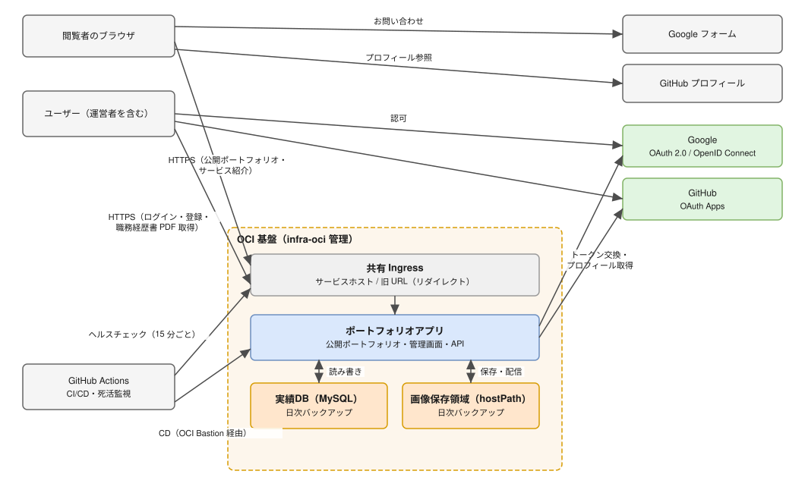
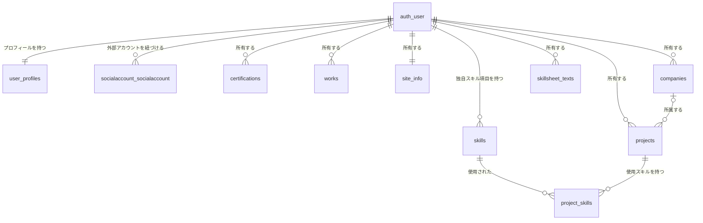
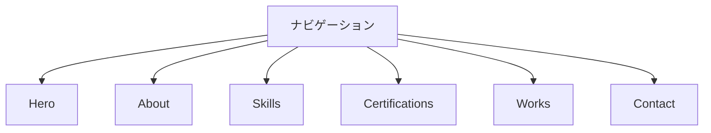
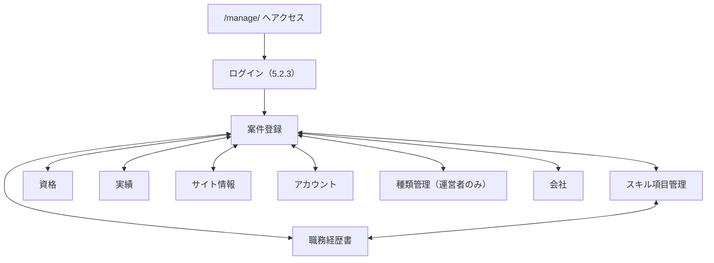
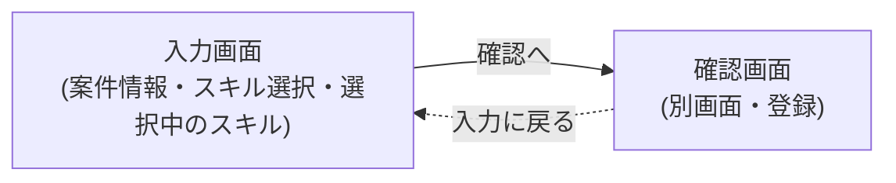
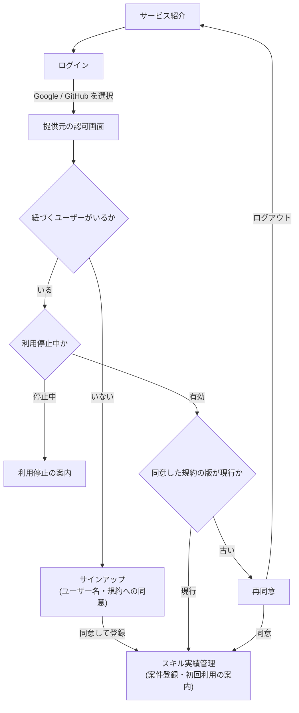
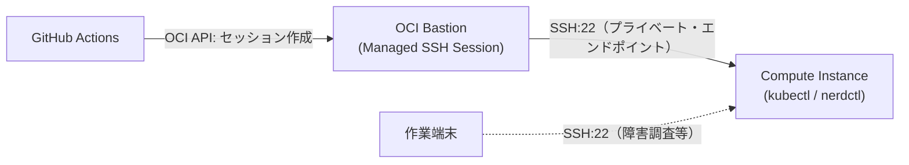
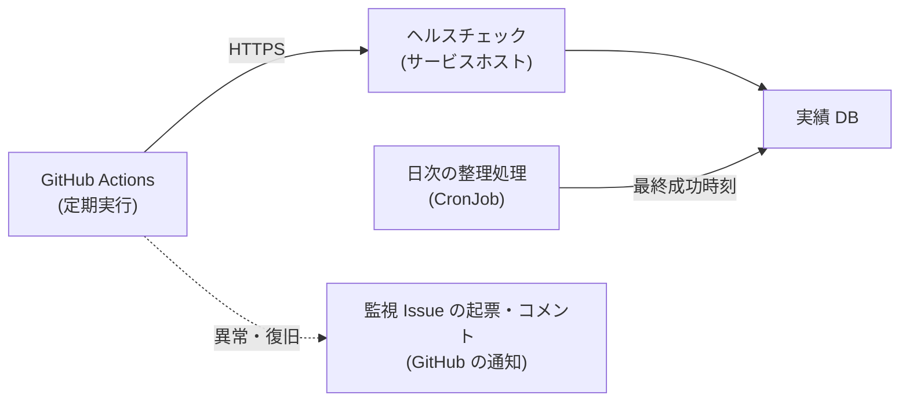

# 基本設計書 - Portfolio（職務経歴書作成サービス）

## 1. システム構成

### 1.1. 前提インフラ

- OCI 基盤（infra-oci リポジトリが管理する Kubernetes クラスタ・MySQL・共有 Ingress・TLS 証明書・
  データベースの日次バックアップ）。基盤自体の構築・運用は infra-oci リポジトリの責務であり、本リポジトリは
  その上で動作するポートフォリオアプリ（コンテナイメージ・アプリケーションコード）のみを管理する。
  公開ポートフォリオ（フロントエンド）のホスティングもこのポートフォリオアプリに含める
- 本サービスは `skillsheet.technohonesty.com`（以下、サービスホスト）のルート（`/`）で公開する。
  サービスホストの DNS レコード・TLS 証明書・Ingress のルールは infra-oci リポジトリが管理する
  （[infra-oci Issue #151](https://github.com/Seiya-Nakagawa/infra-oci/issues/151)）
- 旧 URL（`technohonesty.com/portfolio`）の Ingress のルールは、運営者の公開ポートフォリオへの
  リダイレクトのために残す（[6.5](#65-旧-url-からのリダイレクト)）

### 1.2. 構成図

[別紙: システム構成図](99.appendix/別紙_システム構成図.drawio.svg)



閲覧者のブラウザは、公開ポートフォリオのページ・表示データ（スキル・資格・実績）のいずれも
同一のポートフォリオアプリから取得する。ページ本体とデータ取得用 API が同一オリジンとなるため、
クロスオリジン通信の制御は発生しない。案件情報を含む登録操作は、ログインしたユーザーが自分のデータに
対してのみ行う。

ユーザーのログインは Google・GitHub の OAuth 2.0（OpenID Connect）に委ね、ポートフォリオアプリは
パスワードを保持しない（[4.12](#412-ユーザーとアカウント)・[6.1](#61-外部サービス連携)）。

ポートフォリオアプリ・実績 DB の実体（Kubernetes・MySQL）は infra-oci リポジトリが管理する OCI 基盤上に
配置する。本リポジトリはアプリケーションのソースコード・コンテナイメージ定義・Kubernetes
マニフェスト（Deployment・Service）を管理し、基盤自体のリソース定義は持たない。

## 2. 技術スタック

### 2.1. バージョン確定方針

- 外部ライブラリは最小限に留め、CDN 経由でバージョンを固定して読み込む
- ポートフォリオアプリは、infra-oci 基盤上の既存アプリ（kakeibo）と技術スタックを揃え、
  基盤側の運用手順（コンテナビルド・Kubernetes マニフェストの様式）を再利用する

### 2.2. 採用ライブラリ

| ライブラリ | バージョン | 用途 | 配信元 |
| ---------- | ---------- | ---- | ------ |
| Font Awesome | 6.4.0 | アイコン表示 | cdnjs.cloudflare.com |
| Google Fonts (Shippori Mincho) | 600 / 800 | 見出し・氏名のフォント | fonts.googleapis.com |
| Google Fonts (Zen Kaku Gothic New) | 400 / 500 / 700 | 本文フォント | fonts.googleapis.com |

ポートフォリオアプリ（`webapp/`）の言語・フレームワーク・バージョンは
[`webapp/README.md`](../../webapp/README.md) を正とする。

外部アカウント認証（Google・GitHub の OAuth 2.0 によるサインアップ・ログイン・アカウント連携）は、
Django 向けの認証ライブラリ（django-allauth）を用いて実現し、独自に OAuth のフローを実装しない。
認証は脆弱性が直接ユーザーのデータ漏えいにつながるため、広く使われ保守されている実装を用いる。

## 3. 機能設計

| 機能 | 実現方式 |
| ---- | -------- |
| サインアップ | Google・GitHub の OAuth 認可後、ユーザー名の入力と利用規約・プライバシーポリシーへの同意を求める画面を表示し、同意した場合のみユーザーを作成する。作成と同時に、空のサイト情報・プロフィール（非公開）を作成する（[4.12](#412-ユーザーとアカウント)・[5.3.3](#533-サービス共通)） |
| ログイン・ログアウト | 外部アカウントの OAuth 認可でログインする。パスワードによるログイン・登録の経路は持たない（[4.12](#412-ユーザーとアカウント)） |
| 外部アカウントの追加連携 | ログイン中のユーザーがアカウント画面から別の提供元（Google・GitHub）の認可を行い、同じユーザーに紐づける（[5.3.2](#532-スキル実績管理ポートフォリオアプリ)） |
| ユーザー名の設定 | アカウント画面で変更する。形式・予約語・一意性をサーバー側で検証する（[4.12](#412-ユーザーとアカウント)） |
| 退会 | アカウント画面で、ユーザー名の再入力による確認を経て、ユーザーと所有する全データ・アップロード画像を削除する（[4.13](#413-テナント分離)） |
| 規約の同意管理 | 同意した利用規約・プライバシーポリシーの版をプロフィールに記録する。現行の版と異なるユーザーは、ログイン後の全画面で再同意画面へ誘導する（[4.12](#412-ユーザーとアカウント)） |
| テナント分離 | 共通マスタを除く全データにユーザーへの参照（所有者）を持たせ、全ての参照・登録・変更・削除をログインしたユーザーが所有する行に限定する（[4.13](#413-テナント分離)） |
| 公開・非公開の切替 | 運営者のみ、アカウント画面で切り替え、プロフィールに保持する。一般ユーザー・非公開・存在しない・利用停止中のユーザーの公開ポートフォリオは同一の応答（404）とする（[6.2](#62-公開ポートフォリオ用読み取り専用api)） |
| 運営管理 | 運営者専用の管理画面で、利用状況の集計値の確認・ユーザーの利用停止と再開を行う。共通マスタ・種類マスタの編集は、運営者のみが管理画面から行える（[5.3.4](#534-運営管理)） |
| 流量制限 | 公開ページ・ログイン・PDF 生成・画像アップロードの呼び出し回数を、接続元またはユーザーごとに一定時間あたりで制限する（[7.3](#73-流量制限)） |
| 死活監視 | ヘルスチェック用のエンドポイントを GitHub Actions の定期実行から呼び出し、失敗を運営者へ通知する（[7.2](#72-死活監視)） |
| ナビゲーション | アンカーリンク + CSS によるスムーズスクロール。`js/main.js` でモバイル用ハンバーガーメニューの開閉（Esc キー・リンク選択で閉じる）を制御する |
| Hero 構成レイヤー図 | インフラの構成レイヤー（クラウド・IaC・CI/CD）を等角投影で描いたインライン SVG を Hero に配置する。読み込み時に一度だけレイヤーが積み上がるアニメーションを再生し、動きを減らす設定の環境では無効にする |
| Hero タイピングアニメーション | `js/main.js` が肩書き文字列配列を 1 文字ずつ `#typing-text` に追加・削除してループ再生する。動きを減らす設定の環境では最初の肩書きを固定表示する |
| サイト情報の表示 | ポートフォリオアプリの読み取り専用 API（[6.2](#62-公開ポートフォリオ用読み取り専用api)）を `fetch` で呼び出し、`js/main.js` が Hero（氏名・肩書き・キャッチコピー）、About（自己紹介文・年齢・職業・学歴・居住地・趣味・GitHub URL）、Contact（案内文・問い合わせフォーム URL・GitHub URL）、フッター（氏名・著作権表示の年）を描画する。年齢は API が生年月日から算出して返し、著作権表示の年は API 呼び出し時点の年を返す |
| Skills レベルメーター | ポートフォリオアプリの読み取り専用 API（[6.2](#62-公開ポートフォリオ用読み取り専用api)）を `fetch` で呼び出し、カテゴリ別にグルーピングして描画する |
| 経験年数の算出 | 対象ユーザーの案件実績（開始年月・終了年月・使用スキル）を年月に展開し、スキルごとにユニーク月数を集計して N年Mヶ月 に換算する（[4.10](#410-経験年数の算出)） |
| 案件期間の導出 | 案件実績が保持する開始年月・終了年月をそのまま用いる（[4.11](#411-案件期間の導出)） |
| ポートフォリオ用データ提供 | 集計結果を API のレスポンスとして返す（[6.2](#62-公開ポートフォリオ用読み取り専用api)） |
| 職務経歴書データの管理 | 会社（`companies`）、案件の詳細（`projects` の詳細列）、文章項目（`skillsheet_texts`）を管理画面から項目ごとに登録・編集する（[4.9](#49-職務経歴書データ)・[5.3.2](#532-スキル実績管理ポートフォリオアプリ)） |
| 職務経歴書 PDF 生成 | 実績 DB の会社・案件・スキル実績・資格・文章項目から職務経歴書の Markdown を組み立て、HTML を経由して A4 の PDF に変換して返す。PDF はダウンロードのたびに生成し、サーバーに保存しない（[6.3](#63-職務経歴書の生成)） |
| アクセス制御 | 登録・変更操作はログインを要する画面からのみ実行でき、操作の対象はログインしたユーザーが所有するデータに限る（[4.13](#413-テナント分離)・[6.4](#64-ポートフォリオアプリ)） |
| 案件実績登録 | 案件の開始年月・終了年月（継続中の場合は未設定）とスキル項目のチェック状態を、その案件の実績として登録・更新する（[5.3.2](#532-スキル実績管理ポートフォリオアプリ)） |
| 直近案件の初期表示 | 登録画面の初期状態として、直近案件（終了年月が未設定の案件。なければ終了年月が最も新しい案件）の登録内容を表示する（[5.3.2](#532-スキル実績管理ポートフォリオアプリ)） |
| スキル項目の 1 画面登録 | 案件登録画面で、スキル項目を `category` 単位のタブで切り替えながら 1 画面上で選択し、選択中の項目を常時表示する。パブリッククラウドの各提供元（AWS・Azure・OCI 等）も `category` の一つとして同じ仕組みでタブ化される（[5.3.2](#532-スキル実績管理ポートフォリオアプリ)） |
| スキル項目の管理 | ユーザーは独自スキル項目の追加・変更・削除を画面から行う。共通マスタの追加・変更は運営者のみが行う。実績が紐づく項目は削除できない（[4.3](#43-skillsスキル項目)・[5.3.2](#532-スキル実績管理ポートフォリオアプリ)） |
| 初回利用の案内 | 案件が 1 件も登録されていないユーザーには、案件登録画面の上部に、案件の登録 → 会社・文章項目の入力 → 職務経歴書の取得の手順を案内する（[5.3.2](#532-スキル実績管理ポートフォリオアプリ)） |
| Certifications 資格一覧 | ポートフォリオアプリの読み取り専用 API（[6.2](#62-公開ポートフォリオ用読み取り専用api)）を `fetch` で呼び出し、`js/main.js` が `#certifications-container` に描画する |
| Works 実績カード | ポートフォリオアプリの読み取り専用 API（[6.2](#62-公開ポートフォリオ用読み取り専用api)、`title` / `desc_ja` / リンク等）を `fetch` で呼び出し、`js/main.js` が `#works-container` に描画する |
| 資格・実績の管理 | ポートフォリオアプリの登録画面から資格（`certifications`）・実績（`works`）の追加・変更・削除を行う（[5.3.2](#532-スキル実績管理ポートフォリオアプリ)） |
| Contact | ユーザーが設定した問い合わせフォーム URL・GitHub プロフィール URL へのリンク（サイト内フォーム処理は持たない） |
| サービス紹介・規約の掲示 | サービス紹介・利用規約・プライバシーポリシーは、リポジトリで管理するテンプレートとして配信し、ログインなしで閲覧できる。運営者への問い合わせは Google フォームへのリンクとする（[5.3.3](#533-サービス共通)） |
| 表示文言の切り出し | `js/i18n.js` に `data-i18n` 属性と対応する文言を保持する。`currentLang` は `'ja'` に固定しており、言語切替 UI・英語リソースは持たない |

## 4. データ設計

### 4.1. 共通方針

- スキル・案件・使用実績・資格・実績・職務経歴書データの蓄積先は、infra-oci 基盤の MySQL 上に配置する実績 DB とする
- 実績 DB は本リポジトリでは管理しない（テーブル定義・マイグレーションは `webapp/` 配下のアプリケーション
  コードで管理し、データベース自体のプロビジョニングは infra-oci リポジトリの責務とする）
- 各テーブルの列名は半角英小文字のスネークケースとする
- 年月は `YYYY-MM` 形式の文字列で保持する
- 継続中の案件は終了年月を空文字列（または NULL）とし、未確定の状態を表す
- 実績の有無はレコードの有無で表す。有効・無効を示すフラグ列を持たない
- 集計値（経験年数・ユニーク月数）はテーブルに保持せず、API 呼び出し時に都度算出する。
  実績と集計値が二重管理になることを避けるため
- スキーマの追加・変更はアプリケーションのマイグレーションで管理し、
  手作業によるテーブル操作を行わない
- 共通マスタ（共通マスタのスキル項目・種類マスタ）を除く全てのテーブルは、所有するユーザーを
  `owner_id`（`auth_user` の `id`）で直接または親テーブル経由で参照する。ユーザーの削除時は、
  所有する行をデータベースの連鎖削除でまとめて削除する（[4.13](#413-テナント分離)）
- 他のユーザーの行との一意性を問わない列（会社名・資格名等）は、ユーザー内でのみ一意性を検証する

### 4.2. テーブル構成

| テーブル名 | 役割 | キー | 所有者 |
| ---------- | ---- | ---- | ------ |
| `auth_user` | ユーザー（ユーザー名・メールアドレス・有効状態・運営者の区分）。Django の認証機能の標準テーブル | `id` | - |
| `user_profiles` | ユーザーのプロフィール（公開設定・規約の同意状況） | `user_id` | `user_id` |
| `socialaccount_*` | 外部アカウントとの紐づけ・OAuth のトークン。認証ライブラリの標準テーブル | （ライブラリの定義） | `user_id` |
| `skills` | スキル項目（共通マスタ・独自スキル項目） | `skill_id` | `owner_id`（共通マスタは空） |
| `skill_categories` | スキル項目の種類マスタ（種類の一覧と並び順） | `id` | なし（共通） |
| `projects` | 案件実績（期間） | `project_id` | `owner_id` |
| `project_skills` | 案件ごとの使用スキル実績 | `project_id` + `skill_id` | `projects` 経由 |
| `certifications` | 資格 | `certification_id` | `owner_id` |
| `works` | 実績（Works） | `work_id` | `owner_id` |
| `site_info` | 公開ポートフォリオの表示情報（Hero・About・Contact・フッター。ユーザーごとに 1 行） | `site_info_id` | `owner_id` |
| `companies` | 会社（職務経歴書に記載する所属先・副業の契約先） | `company_id` | `owner_id` |
| `skillsheet_texts` | 職務経歴書の文章項目（ユーザー・項目ごとに 1 行） | `skillsheet_text_id` | `owner_id` |
| `usage_daily` | 利用状況の日次集計値（運営管理用。ユーザーを参照しない） | `usage_date` + `metric` | なし |
| `released_usernames` | 変更・退会で解放したユーザー名の予約（一定期間、他のユーザーが取得できないようにする。[4.12](#412-ユーザーとアカウント)） | `username` | なし |
| `job_runs` | 定期ジョブの最終成功時刻（死活監視の判定に用いる。[7.2](#72-死活監視)） | `job_name` | なし |



案件が期間（開始年月・終了年月）を保持し、案件ごとの使用スキルを `project_skills` に記録する。
登録操作を「対象案件の期間を入力し、使用したスキル項目をチェックする」1 セットに収めるためであり、
経験年数・案件期間・両出力に必要な情報はこの構成で充足する。

`certifications`・`works`・`site_info` は `skills`・`projects` と参照関係を持たない独立したテーブルとし、
公開ポートフォリオへの表示のみを目的とする（`certifications` は職務経歴書の保有資格にも用いる）。
`works`・`site_info` は運営者のみが登録する。一般ユーザーが登録済みの行は削除せずに保持し、公開も編集もしない。

テーブル間の参照は同じユーザーが所有する行どうしに限る。案件が参照する会社、使用実績が参照する
スキル項目（共通マスタを除く）は、案件と同じユーザーが所有するものでなければならず、保存時に
サーバー側で検証する。

`companies` は職務経歴書の会社見出しの単位であり、案件は `company_id` で所属する会社を参照する。
職務経歴書の案件の表（期間・案件名・案件の詳細）は `projects` の値をそのまま用い、
案件名の文字列の一致による対応付けは行わない。`skillsheet_texts` は他のテーブルと参照関係を持たない。

### 4.3. `skills`（スキル項目）

| 列名 | 型 | 必須 | 内容 |
| ---- | -- | ---- | ---- |
| `skill_id` | 文字列 | ○ | スキル項目の識別子。半角英小文字・数字・ハイフンで構成し、登録後は変更しない。共通マスタは種データ・運営者が採番し（下記）、独自スキル項目はサーバー側で `u-` に推測されにくい文字列を続けて採番する（ユーザーには入力させない） |
| `owner_id` | 整数 | - | 独自スキル項目を所有するユーザー（`auth_user` の `id`）。共通マスタは空とする |
| `category` | 文字列 | ○ | 種類。`skill_categories` の `name` と一致させる。ポートフォリオのカテゴリ見出し、職務経歴書の「種類」列、案件登録画面のページ単位に対応する |
| `subcategory` | 文字列 | - | サブカテゴリ。項目数の多い `category`（AWS 等）を案件登録画面でサブタブに分けるための区分。空文字の場合は区分しない。ポートフォリオ・職務経歴書には表示しない |
| `name` | 文字列 | ○ | 表示名。ポートフォリオ・職務経歴書に共通で使用する |
| `sort_order` | 整数 | ○ | 共通マスタを通した表示順。管理画面では入力せず、種類の並び順と自動ソート（種類内はサブカテゴリ ＞ 表示名の昇順）から自動で採番する。独自スキル項目は 0 とし、表示順は下記の規則で表示時に決める |
| `is_master` | 真偽値 | ○ | 共通マスタか。種データから登録した項目と運営者が追加した項目は真、ユーザーが追加した独自スキル項目は偽。`owner_id` が空であることと一致させる |

- ユーザーが選択・参照できるスキル項目は、共通マスタと自分の独自スキル項目に限る。他のユーザーの
  独自スキル項目は、一覧・選択肢・API のいずれにも出力しない
- 独自スキル項目の `category` は既存の種類から選ぶ。種類の追加は運営者のみが行う
- 独自スキル項目は、同じユーザーの同じ `category` 内で `name` を重複させない。共通マスタに同じ
  `category`・`name` の項目がある場合も登録させず、共通マスタの項目を選ぶよう案内する
- 独自スキル項目の表示順は、同じ `category` の共通マスタの後ろに、`subcategory` ＞ `name` の昇順で並べる。
  ユーザーの追加のたびに全ユーザーに共通する `sort_order` を採番し直さないため
- 共通マスタは、いずれかのユーザーの使用実績が紐づく間は削除できない。名称の変更は、選択している
  全ユーザーの表示・職務経歴書に反映される
- 共通マスタに、ユーザーの独自スキル項目と同じ `category`・`name` の項目を後から追加した場合
  （運営者の追加・種データの取り込みのいずれも）、二重に表示されないよう、同じトランザクションで
  該当する独自スキル項目を共通マスタの項目へ統合する。統合は、独自スキル項目に紐づく使用実績を共通マスタの項目へ
  付け替えて、独自スキル項目を削除する。同じ案件にすでに共通マスタの項目の使用実績がある場合は、
  独自スキル項目の使用実績を削除する（期間・経験年数は案件の期間から導出するため失われない）

#### 4.3.1. `skill_categories`（種類マスタ）

| 列名 | 型 | 必須 | 内容 |
| ---- | -- | ---- | ---- |
| `id` | 整数 | ○ | 自動採番の識別子 |
| `name` | 文字列 | ○ | 種類名。重複不可。`skills` の `category` と同じ値で対応付ける（外部キーは持たない） |
| `sort_order` | 整数 | ○ | 種類の表示順。ポートフォリオ・職務経歴書・案件登録画面の種類の並び順を決める |

種類マスタは全ユーザーで共有し、追加・名称変更・並び替え・削除は運営者のみが行う。
スキル項目を持たない種類も登録できる。種類の名称変更は、対応する `skills` の `category`
（全ユーザーの独自スキル項目を含む）も同時に更新する。

種類の追加・名称変更・削除と、その種類の独自スキル項目の追加・変更は、同じ種類の行を排他ロック
（`SELECT ... FOR UPDATE`）してから実施する。名称変更・削除の最中に、旧名称の種類で独自スキル項目が
作成・更新されて、種類マスタに存在しない `category` が残るのを防ぐため。独自スキル項目の保存時は、
ロックした種類の行が存在することも確認する。

ポートフォリオと職務経歴書で異なるスキル項目一覧を持たない。両者の出力対象は本テーブルに一本化する。

パブリッククラウドは、クラウドサービス提供元（AWS・Azure・OCI 等）を `category` とし、
提供元が持つサービス（EC2・VPC・RDS 等）を `name` に持つスキル項目として、他のスキル項目と
同様に本テーブルへ登録する。「パブリッククラウド」という単一の `category` や、クラウド名を
`name` とするスキル項目は持たない。クラウドの提供元単位で経験年数を管理する上位項目は
設けず、サービス単位の項目のみを管理する。
パブリッククラウド（AWS・Azure・Google Cloud・OCI）は、各提供元の公式サイトが公開するサービス一覧から
取得したサービスを網羅して登録する。サブカテゴリは公式サイトのサービスカテゴリに従う。

| 提供元 | 取得元（公式サイト） |
| ------ | -------------------- |
| AWS | aws.amazon.com の製品ディレクトリ（種別が Service のもの） |
| Azure | azure.microsoft.com の製品一覧（カテゴリ別） |
| Google Cloud | docs.cloud.google.com の AWS・Azure・Google Cloud サービス比較表 |
| OCI | docs.oracle.com の OCI ドキュメントのサービス一覧（カテゴリ別） |

種データのクラウド部分は、取得用スクリプト（`scripts/fetch_cloud_services.py`）で公式サイトから再取得して更新する。
言語・フレームワーク・DB・OS・ミドルウェア・IaC・コンテナ・CI/CD・監視・ログ分析・ジョブ管理・
クラスタリング・ツール・セキュリティ・ネットワークの各 `category` は、一般公開を想定して汎用的な項目を登録する。
網羅の対象はリポジトリの種データ（`skills_master.json`）で定義し、デプロイ時にコマンド
（`import_skill_master`）が、未登録の `category`・スキル項目のみを追加する（下記）。

- 既に登録済みのスキル項目（同じ `category` で、提供元の接頭辞・空白・記号・括弧書きの別名を除いた
  名前が一致するもの）は変更しない。`name`・`subcategory`・`skill_id` を上書きしない
- 追加する項目の `skill_id` は、`category` ごとの接頭辞（`aws-`・`azure-`・`gcp-`・`oci-`）に名前から作った
  半角英小文字・数字・ハイフンの文字列を続け、既存と重複する場合は連番を付ける。汎用の `category` は接頭辞を付けない
- 追加した項目は `subcategory`（パブリッククラウドは提供元公式のサービスカテゴリ）を設定し、追加後に
  `sort_order` を採番し直す。新しい `category` は種類マスタの末尾に追加する
- 種データから追加した項目は `is_master` を真とし、ユーザーは削除できない。
  既に登録済みの共通マスタで種データと一致した項目は、`name`・`subcategory`・`skill_id` を変更しない
- 既存の項目との一致の判定は共通マスタのみを対象とし、ユーザーの独自スキル項目は種データの取り込みで変更しない
- 網羅の更新は種データの更新で行い、デプロイ時に反映する

AWS のように項目数が多い提供元は、`subcategory` に AWS 公式のサービスカテゴリ（Compute・
Networking & Content Delivery 等）を設定して区分する。
AWS のサービスは、他の `category`（コンテナ・データベース等）には登録せず、すべて `category` が AWS の
スキル項目に集約する。

### 4.4. `projects`（案件実績）

| 列名 | 型 | 必須 | 内容 |
| ---- | -- | ---- | ---- |
| `project_id` | 文字列 | ○ | 案件の識別子。案件登録画面では入力させず、サーバー側で全ユーザーを通して一意かつ推測されにくい値を自動採番する。登録後は変更しない |
| `owner_id` | 整数 | ○ | 所有するユーザー（`auth_user` の `id`） |
| `name` | 文字列 | ○ | 案件名。案件登録画面での識別と、職務経歴書の案件見出しに共通で用いる |
| `start_year_month` | 文字列 | ○ | 開始年月（`YYYY-MM`） |
| `end_year_month` | 文字列 | - | 終了年月（`YYYY-MM`）。空値の場合は継続中を表す |
| `company_id` | 整数 | - | 所属する会社（`companies` の `company_id`。同じユーザーが所有する会社に限る）。未設定の案件は職務経歴書に出力しない |
| `team_size` | 文字列 | - | 体制（例: `14名体制`）。職務経歴書の案件の表の `役割・規模` 列に出力する |
| `overview` | 文字列（長文） | - | 案件概要 |
| `tasks` | 文字列（長文） | - | 業務内容。1 行を 1 項目とする |
| `phases` | 文字列 | - | 担当工程。選択した工程を下記の選択肢の順に「、」で連結して保持する（例: `基本設計、詳細設計`） |
| `environment` | 文字列（長文） | - | 環境・言語。1 行を 1 項目（例: `AWS`、`Python 3.14`）として保持し、職務経歴書には「、」で連結して出力する。画面からは 1 項目ずつ分けて入力する。512 文字以内 |

担当工程の選択肢は次の 8 つとし、アプリケーションで固定する（この順に並べて保持・出力する）。

| 工程 |
| ---- |
| 要件定義 |
| 基本設計 |
| 詳細設計 |
| 実装 |
| 単体テスト |
| 結合テスト |
| 総合テスト |
| 運用・保守 |

- 選択肢にない値は保存できない。ただし、選択肢の導入前に自由入力された値は、その案件に保持されている間に限り、
  編集画面にも選択済みのチェック項目（選択肢の末尾）として表示し、そのまま保存できる（編集で値を失わないため）。
  チェックを外すと、その値は削除される

案件は期間（`start_year_month`）から表示順が一意に定まるため、スキル項目マスタと異なり
`sort_order` 列は持たない。

`company_id` 以降の列（以下、案件の詳細）は職務経歴書にのみ用いる任意項目とし、空の項目は職務経歴書に出力しない。
「環境・言語」は `project_skills` の使用スキルとは別に保持する。職務経歴書向けに製品名・バージョンの
表記を自由に記述するためであり、経験年数の算出には用いない。

案件の削除は、紐づく `project_skills` の実績も同時に削除する。経験年数の算出結果に影響するため、
削除前に画面上で確認を求める（[5.3.2](#532-スキル実績管理ポートフォリオアプリ)）。

### 4.5. `project_skills`（案件ごとの使用スキル実績）

| 列名 | 型 | 必須 | 内容 |
| ---- | -- | ---- | ---- |
| `project_id` | 文字列 | ○ | `projects` の `project_id` を参照する |
| `skill_id` | 文字列 | ○ | `skills` の `skill_id` を参照する |
| `version` | 文字列 | - | その案件でそのスキル項目を使用した際のバージョン（例: `3.14`、`X 5.3`）。バージョンの概念がない項目や、特定しない場合は空文字列とする |

- 1 行が「ある案件であるスキル項目を使用した」1 件の実績を表す縦持ち形式とする
- `project_id` と `skill_id` の組み合わせは一意とし、重複して登録しない
- `version` はスキル項目マスタ（`skills`）ではなく案件ごとの実績側で保持する。同一のスキル項目でも
  案件によって使用したバージョンが異なりうるため

### 4.6. `certifications`（資格）

| 列名 | 型 | 必須 | 内容 |
| ---- | -- | ---- | ---- |
| `certification_id` | 整数 | ○ | 資格の識別子。サーバー側で自動採番する |
| `owner_id` | 整数 | ○ | 所有するユーザー（`auth_user` の `id`） |
| `name` | 文字列 | ○ | 資格名 |
| `acquired_on` | 日付 | ○ | 取得年月。年月の粒度で管理し、その月の 1 日を保持する。表示は `YYYY年MM月` に整形する。表示順はこの日付の昇順（古い順）とし、同じ年月は登録の古い順（`certification_id` の昇順）とする |
| `org` | 文字列 | ○ | 発行団体 |

### 4.7. `works`（実績）

| 列名 | 型 | 必須 | 内容 |
| ---- | -- | ---- | ---- |
| `work_id` | 整数 | ○ | 実績の識別子。サーバー側で自動採番する |
| `owner_id` | 整数 | ○ | 所有するユーザー（`auth_user` の `id`） |
| `title` | 文字列 | ○ | 実績タイトル |
| `desc_ja` | 文字列 | ○ | 説明文（日本語） |
| `desc_en` | 文字列 | - | 説明文（英語） |
| `tags` | 文字列（JSON 配列） | - | 使用技術タグの一覧 |
| `thumbnail` | 文字列 | - | サムネイル画像の保存先（アップロード画像の保存領域からの相対パス。省略時は既定のプレースホルダーを使う） |
| `github_url` | 文字列 | - | GitHub リポジトリへのリンク |
| `achieved_on` | 日付 | ○ | 実績年月。年月の粒度で管理し、その月の 1 日を保持する。表示は `YYYY年MM月` に整形する。日付の導入前に登録した行は未設定を許容し、更新時に入力を必須とする |
| `live_url` | 文字列 | - | 公開 URL へのリンク |

表示順は `achieved_on` の降順（未設定は末尾）、同じ年月は登録の新しい順（`work_id` の降順）とする。

### 4.8. `site_info`（サイト全体の表示情報）

公開ポートフォリオの Hero・About・Contact・フッターに表示する情報を保持する。行はユーザーごとに 1 件とし、
サインアップ時に初期値（氏名等は空、著作権開始年は登録年）で作成する。ユーザーの操作では追加・削除は行わず変更のみとする。
未入力の項目は、公開ポートフォリオの該当箇所を空欄として表示する。
ナビゲーション・セクション見出し・表の列名などの固定ラベルは
サイトの構造の一部であり、頻繁に更新されないため本テーブルでは管理しない。

| 列名 | 型 | 必須 | 内容 |
| ---- | -- | ---- | ---- |
| `site_info_id` | 整数 | ○ | 識別子。サーバー側で自動採番する |
| `owner_id` | 整数 | ○ | 所有するユーザー（`auth_user` の `id`）。ユーザー間で重複しない |
| `name` | 文字列 | ○ | 氏名（Hero・フッターに表示） |
| `typing_titles` | 文字列（JSON 配列） | ○ | Hero のタイピングアニメーションに表示する肩書きの一覧 |
| `catchphrase` | 文字列 | ○ | Hero のキャッチコピー |
| `intro` | 文字列 | ○ | About の自己紹介文（改行を含む） |
| `birth_date` | 日付 | ○ | 生年月日。年齢の算出にのみ用い、公開 API へは出力しない |
| `job` | 文字列 | ○ | 職業 |
| `education` | 文字列 | ○ | 学歴 |
| `location` | 文字列 | ○ | 居住地 |
| `hobby` | 文字列 | ○ | 趣味 |
| `github_url` | 文字列 | ○ | GitHub URL（About・Contact で共用） |
| `contact_message` | 文字列 | ○ | Contact の案内文（改行を含む） |
| `contact_form_url` | 文字列 | ○ | 問い合わせフォームの URL |
| `copyright_start_year` | 整数 | ○ | フッターの著作権表示の開始年。表示は `開始年-現在の年` とし、開始年と現在の年が同じ場合は 1 つの年のみ表示する |

### 4.9. 職務経歴書データ

職務経歴書の記載内容のうち、案件実績・スキル項目・資格から生成しない部分を保持する。
いずれも最新版のみを保持し、変更履歴は持たない。

#### 4.9.1. `companies`（会社）

| 列名 | 型 | 必須 | 内容 |
| ---- | -- | ---- | ---- |
| `company_id` | 整数 | ○ | 会社の識別子。サーバー側で自動採番する |
| `owner_id` | 整数 | ○ | 所有するユーザー（`auth_user` の `id`） |
| `name` | 文字列 | ○ | 会社名（例: `株式会社〇〇`） |
| `department` | 文字列 | - | 部署名 |
| `employment_type` | 文字列 | - | 雇用・契約形態（例: `正社員`、`業務委託`） |
| `kind` | 文字列 | ○ | 区分。`main`（本業）または `side`（副業）。職務経歴書の `■開発経歴`・`■副業` のどちらに記載するかを決める |
| `start_year_month` | 文字列 | ○ | 在籍開始年月（`YYYY-MM`） |
| `end_year_month` | 文字列 | - | 在籍終了年月（`YYYY-MM`）。空値の場合は在籍中を表す |
| `capital` | 文字列 | - | 資本金（例: `200万円`） |
| `employees` | 文字列 | - | 従業員数（例: `連結3,387名`） |
| `offices` | 文字列 | - | 拠点数（例: `8拠点`） |
| `annual_sales` | 文字列 | - | 年商（例: `222億円`） |
| `founded` | 文字列 | - | 設立（例: `2008年5月`） |

- 会社概要の列（`capital` 〜 `founded`）は、職務経歴書に記載する文言をそのまま保持する。
  集計・比較に用いないため数値化しない
- 表示順は `kind` ごとに `start_year_month` の降順とし、同じ年月は `company_id` の昇順とする
- 所属する案件がある会社は削除できない

#### 4.9.2. `skillsheet_texts`（職務経歴書の文章項目）

| 列名 | 型 | 必須 | 内容 |
| ---- | -- | ---- | ---- |
| `skillsheet_text_id` | 整数 | ○ | 識別子。サーバー側で自動採番する |
| `owner_id` | 整数 | ○ | 所有するユーザー（`auth_user` の `id`） |
| `text_key` | 文字列 | ○ | 項目のキー（下表）。`owner_id` と `text_key` の組み合わせは一意とする |
| `body` | 文字列（長文） | ○ | 内容。`full_name` は 1 行の文字列、それ以外は Markdown（段落・箇条書き・太字）とする |
| `updated_at` | 日時 | ○ | 最終更新日時。保存時にサーバー側で設定する |

| `text_key` | 項目 | 職務経歴書の出力先 |
| ---------- | ---- | ------------------ |
| `full_name` | 氏名 | 冒頭の `氏名:` |
| `summary` | 職務概要 | `■職務概要` |
| `strengths` | 活かせる経験・得意分野 | `■活かせる経験・得意分野` |
| `self_pr` | 自己PR | `■自己PR` |

- 項目の種類はアプリケーションで固定し、画面から追加・削除しない
- 行が存在しない項目は未入力として扱い、初回の保存で作成する。削除は行わない
- 項目の見出し（`■職務概要` 等）は職務経歴書の生成時に付与するため、`body` には含めない。
  `body` を Markdown とするのは、自己PR の小見出し（太字）や得意業務の箇条書きなど、項目内の書式を保つため
- 保存は項目ごとに、編集を開始した時点の `updated_at` を添えて行い、保存時点の値と一致しない場合は保存しない。
  変更履歴を持たないため、複数タブからの保存で後勝ちによる上書きが起きないようにする

### 4.10. 経験年数の算出

1. 出力時点の年月を基準日とする。集計の対象は、対象ユーザーが所有する案件に限る
2. `projects` の各行について、`start_year_month` から `end_year_month`（空値の場合は基準日）
   までを年月に展開する
3. `project_skills` で案件に紐づく `skill_id` ごとに、その案件に紐づく全案件の展開年月を
   和集合し、異なり数をユニーク月数とする。同一年月に複数の案件で同一のスキル項目を使用した
   場合も 1 ヶ月として数える
4. ユニーク月数を 12 で除した商を年数、剰余を月数とする
5. 以下の規則で表記に変換する

| 条件 | 表記 | 例 |
| ---- | ---- | -- |
| ユニーク月数が 0 | 出力対象外とする | - |
| ユニーク月数が 12 未満 | `Mヶ月` | `7ヶ月` |
| 12 以上かつ剰余が 0 | `N年` | `4年` |
| 12 以上かつ剰余が 0 以外 | `N年Mヶ月` | `4年10ヶ月` |

ポートフォリオのスキル表示では、ユニーク月数から以下の規則で星の段階（1〜5）を算出する。

| 星 | ユニーク月数 | 経験年数 |
| -- | ------------ | -------- |
| 1 | 6 未満 | 半年未満 |
| 2 | 6 以上 12 未満 | 半年以上 1 年未満 |
| 3 | 12 以上 36 未満 | 1 年以上 3 年未満 |
| 4 | 36 以上 60 未満 | 3 年以上 5 年未満 |
| 5 | 60 以上 | 5 年以上（最上位） |

- 使用実績が 1 件も存在しないスキル項目は、ポートフォリオ・職務経歴書のいずれにも出力しない
- 職務経歴書の「開始年」は、そのスキル項目が紐づく案件の `start_year_month` の最小値の年とする

### 4.11. 案件期間の導出

- `projects` の `start_year_month`・`end_year_month` をそのまま用いる
- `end_year_month` が空値の場合は継続中とみなし、終了年月を「現在」と表記する
- 表記は `YYYY年MM月〜YYYY年MM月`、継続中の場合は `YYYY年MM月〜現在` とする

### 4.12. ユーザーとアカウント

ユーザーは Django の認証機能の標準テーブル（`auth_user`）で管理し、本サービス固有の情報は
`user_profiles` に保持する。外部アカウントとの紐づけは認証ライブラリの標準テーブル（`socialaccount_*`）が保持する。

`auth_user` の主な列の用途。

| 列名 | 用途 |
| ---- | ---- |
| `username` | ユーザー名。運営者の公開ポートフォリオの URL に用いる（下記の規則） |
| `email` | 外部アカウントから取得したメールアドレス。運営者からの連絡と、外部アカウントの紐づけの判定に用いる。公開しない |
| `is_active` | 有効状態。偽の場合は利用停止中とし、ログインと公開ポートフォリオの表示を停止する |
| `is_staff` | 運営者か。真のユーザーのみ運営管理画面・共通マスタの編集・公開ポートフォリオ（公開設定・実績・サイト情報）を利用できる |
| `password` | 使用しない。全ユーザーについて、パスワードでログインできない状態（使用不可の値）とする |

`user_profiles`。

| 列名 | 型 | 必須 | 内容 |
| ---- | -- | ---- | ---- |
| `user_id` | 整数 | ○ | ユーザー（`auth_user` の `id`）。1 ユーザーに 1 行 |
| `is_public` | 真偽値 | ○ | 公開ポートフォリオを公開するか。サインアップ時は偽。運営者のみ有効とし、一般ユーザーは真であっても公開しない |
| `terms_version` | 文字列 | - | 同意した利用規約の版。未同意の場合は空 |
| `privacy_version` | 文字列 | - | 同意したプライバシーポリシーの版。未同意の場合は空 |
| `agreed_at` | 日時 | - | 最後に同意した日時 |

ユーザー名の規則。

| 項目 | 規則 |
| ---- | ---- |
| 形式 | 半角英小文字で始まり、半角英小文字・数字・ハイフンからなる 3〜30 文字。末尾のハイフン・連続するハイフンは不可 |
| 一意性 | 全ユーザーで一意。大文字・小文字の違いは区別しない（入力は小文字に揃える） |
| 予約語 | サービスのパスや運営上の名称と紛らわしい語（`admin`・`api`・`manage`・`accounts`・`static`・`media`・`u`・`terms`・`privacy`・`support` 等）は使えない。一覧はアプリケーションで定義する |
| 変更 | アカウント画面から変更できる。変更後は旧ユーザー名の URL を 404 とする |
| 解放後の予約 | 変更・退会で解放したユーザー名は `released_usernames` に記録し、解放から 90 日間は他のユーザーが取得できない（旧 URL を別人が取得して、旧 URL の閲覧者に成りすますのを防ぐ）。解放した本人は期間内でも取り直せる（取り直した時点で予約の行を削除する）。期限切れの行は日次の整理処理で削除する |
| 運営者のユーザー名 | 旧 URL からのリダイレクト先（[6.5](#65-旧-url-からのリダイレクト)）は、運営者のユーザー名を設定値で持つ。運営者がユーザー名を変更する場合は、同じリリースで設定値も更新する（更新しないと転送先が 404 になる） |

認証の方針。

- サインアップ・ログインは外部アカウント（Google・GitHub）のみとする。取得する情報は、外部アカウントの
  識別子・メールアドレス・表示名に限り、OAuth のスコープもこの取得に必要な最小限とする
- 外部アカウントのメールアドレスが既存ユーザーのメールアドレスと一致し、かつ提供元が検証済みとしている場合に限り、
  その既存ユーザーに紐づける。検証済みでない場合は紐づけず、新規のサインアップとして扱う
- 利用規約・プライバシーポリシーの現行の版はアプリケーションの設定で定義する。版を改定した場合、
  ログイン中のユーザーのうち同意した版が現行と異なるユーザーを、ログイン後の全画面で再同意画面へ誘導する
  （再同意画面・ログアウト・規約の閲覧・静的ファイルを除く）
- 利用停止中のユーザーは、外部アカウントの認可が成功してもログインさせず、既存のセッションも無効として扱う
- 退会など取り消せない操作は、直近のログインを要求する。外部アカウントで認証した時刻をセッションに記録し、
  現在時刻との差が 10 分（アプリケーションの設定で定義する）を超える場合、または時刻が記録されていない
  セッションでは操作を拒否（403）し、画面は外部アカウントでの再ログインを案内する。再ログイン後は
  アカウント画面へ戻り、同じ操作を続けられる

### 4.13. テナント分離

ユーザー間のデータの分離は、アプリケーション層で次のとおり強制する。

| 項目 | 方式 |
| ---- | ---- |
| 所有者の付与 | 登録時の所有者は、リクエストの値ではなく常にログインしたユーザーとする。リクエストに含まれる所有者の値は無視する |
| 参照の限定 | 管理画面の API は、対象の行を常に「識別子かつ所有者がログインしたユーザー」の条件で取得する。所有者が異なる行は存在しないものとして 404 を返し、存在を推測させない |
| 所有者を限定する取得口の一本化 | 所有者で絞り込んだ取得をモデル層の共通の取得口にまとめ、各 API はその取得口を経由する。所有者の絞り込みを各 API の個別実装に委ねない |
| 参照先の検証 | 案件が参照する会社・使用実績が参照するスキル項目が、同じユーザーの所有（または共通マスタ）であることを保存時に検証する |
| 集計・生成 | 経験年数の集計・公開ポートフォリオ用 API・職務経歴書の生成は、対象ユーザーを引数として受け取り、そのユーザーの行のみを読み込む |
| アップロード画像 | ユーザーごとの保存先（`users/{ユーザーの id}/`）に保存し、配信時に所有者の公開設定と閲覧者を検証する（[5.3.2](#532-スキル実績管理ポートフォリオアプリ)） |
| 運営者の権限 | 運営者も、管理画面の API では自分のデータのみを操作する。運営管理画面には、他のユーザーの案件・会社・職務経歴書データを表示する機能を持たせない |
| 自動テスト | 管理画面の全 API・公開 API・画像配信・職務経歴書の生成について、2 人のユーザーを用意し、一方が他方のデータを参照・変更・削除できないこと（404 となること）をテストで検証する。API を追加する際は同じテストに追加する |

退会時の削除。

1. 直近のログイン（[4.12](#412-ユーザーとアカウント)）と、ユーザー名の再入力による確認を経て実行する
2. `auth_user` の行を削除し、所有する行（プロフィール・外部アカウントの紐づけ・独自スキル項目・案件・
   使用実績・資格・実績・サイト情報・会社・文章項目）を連鎖削除する。データベースの削除は 1 トランザクションで行う
3. トランザクションの確定後、ユーザーの画像の保存先（`users/{ユーザーの id}/`）を削除する
4. セッションを破棄してサービス紹介ページへ戻す
5. 利用状況の日次集計値（`usage_daily`）の退会数を加算する。ユーザーを特定できる情報は残さない
6. 解放したユーザー名を `released_usernames` に記録する（手順 2 と同じトランザクション）

### 4.14. 利用状況の集計（`usage_daily`）

| 列名 | 型 | 必須 | 内容 |
| ---- | -- | ---- | ---- |
| `usage_date` | 日付 | ○ | 集計日 |
| `metric` | 文字列 | ○ | 指標。`signup`（サインアップ数）・`withdrawal`（退会数）・`skillsheet_pdf`（職務経歴書 PDF の生成回数）・`skillsheet_md`（Markdown の生成回数） |
| `count` | 整数 | ○ | 件数。該当する操作のたびに加算する |

- ユーザーへの参照を持たない。退会したユーザーの操作も集計値として残すため
- 加算は付随的な記録であり、加算に失敗しても元の操作（職務経歴書の生成・退会・サインアップ）を失敗させない。
  失敗は警告ログに残し、加算はセーブポイントの内側で行って、呼び出し元のトランザクションを巻き込まない
- 登録ユーザー数・利用停止中のユーザー数は、集計値として保持せず表示時に
  `auth_user`・`user_profiles` から数える

### 4.15. 既存データの移行

単一ユーザー構成で蓄積した運営者のデータを、運営者のユーザーが所有するデータとして移行する。
移行は 1 回のリリースで行い、移行前に実績 DB のダンプを手動で取得して、失敗時はダンプから戻す。

| 順 | 処理 | 方式 |
| -- | ---- | ---- |
| 1 | 所有者の列を追加する | マイグレーションで、各テーブルに空を許す `owner_id` を追加し、`user_profiles`・`usage_daily`・認証ライブラリのテーブルを作成する |
| 2 | 既存の行を運営者に紐づける | データ移行のマイグレーションで、既存の唯一のユーザー（運営者）を所有者として、全テーブルの既存の行の `owner_id` を設定する。ユーザーが 1 人でない場合は移行を中止する。スキル項目は既存の全項目を共通マスタ（`owner_id` は空）とする |
| 3 | 運営者のアカウントを整える | 同じデータ移行で、運営者を `is_staff` とし、プロフィール（公開）を作成し、パスワードを使用不可にする。運営者の外部アカウントは、運営者の `email` を Google アカウントのメールアドレスに合わせたうえで、初回の Google ログイン時に紐づける（[4.12](#412-ユーザーとアカウント)） |
| 4 | 所有者を必須にする | マイグレーションで、共通マスタを持つ `skills` を除く各テーブルの `owner_id` を必須にし、`site_info`・`skillsheet_texts` の一意性の制約を所有者単位に変更する |
| 5 | 画像の保存先を移す | 移行用のコマンドで、既存の画像を `works/` から運営者の保存先（`users/{運営者の id}/works/`）へ移し、`works` の `thumbnail` を更新する。移動済みのファイルは再実行時にスキップする |

運営者のユーザー名は、移行後にアカウント画面から設定する。設定までの間、旧 URL からのリダイレクト先が
存在しないため、移行のリリース後すぐに設定する（[6.5](#65-旧-url-からのリダイレクト)）。

## 5. 画面設計

### 5.1. 画面一覧

本サービスの URL は次の構成とする（パスはサービスホストのルートからのもの）。

| パス | 画面 | ログイン |
| ---- | ---- | -------- |
| `/` | サービス紹介 | 不要 |
| `/terms`・`/privacy` | 利用規約・プライバシーポリシー | 不要 |
| `/robots.txt`・`/sitemap.xml` | 検索エンジン向けの案内（[6.6](#66-検索エンジンsns-向けの情報)） | 不要 |
| `/accounts/` 配下 | ログイン・サインアップ（ユーザー名の入力・規約への同意）・再同意・外部アカウントの認可の戻り先 | 画面による |
| `/u/{ユーザー名}/` | 公開ポートフォリオ | 不要（公開中の運営者のみ） |
| `/manage/` | スキル実績管理（アカウント画面を含む） | 必要 |
| `/admin/` | 運営管理 | 必要（運営者のみ） |

#### 5.1.1. 公開ポートフォリオ

| 画面 | 内容 |
| ---- | ---- |
| `/u/{ユーザー名}/` | Hero / About / Skills / Certifications / Works / Contact の全セクションを含む単一ページ。運営者のページのみを描画する |
| 404 | 一般ユーザー・非公開・存在しない・利用停止中のユーザー名へのアクセスに、区別せず同一の内容で返す |

#### 5.1.2. スキル実績管理（ポートフォリオアプリ）

| 画面 | 内容 |
| ---- | ---- |
| 案件登録 | 継続中の案件（なければ新規案件）の開始年月・終了年月とスキル項目を 1 画面で選んで案件実績を保存する。削除もここで行う。利用頻度の低い操作として、終了済みの案件を選んで登録内容を訂正する枠を別に設ける。ログイン後の初期表示画面とし、案件が未登録のユーザーには初回利用の案内を表示する |
| スキル項目管理 | 共通マスタと自分の独自スキル項目（`skills`）の一覧（種類フィルタ・キーワード検索付き）、独自スキル項目の追加・変更を行う編集画面。運営者は共通マスタも追加・変更できる。編集画面は一覧とは別画面として切り替わる |
| 資格 | `certifications` の一覧・追加・変更・削除 |
| 実績 | `works` の一覧・追加・変更・削除。運営者のみに表示する |
| サイト情報 | `site_info` の表示・変更。運営者のみに表示する |
| 会社 | `companies` の一覧・追加・変更・削除 |
| 職務経歴書 | 職務経歴書のプレビュー（PDF に出力する内容）と PDF・Markdown のダウンロード、文章項目（`skillsheet_texts`）の編集（[6.3](#63-職務経歴書の生成)） |
| 種類管理 | 種類マスタ（`skill_categories`）の一覧・追加・名称変更・削除・並び替え。運営者のみに表示し、ナビゲーションの最下部（「出力・設定」グループ）に分離する |
| アカウント | ユーザー名の変更、外部アカウントの連携状況と追加連携、退会。運営者には公開設定の変更と公開ポートフォリオの URL も表示する |

管理画面の共通レイアウトは次のとおりとする。

| 項目 | 内容 |
| ---- | ---- |
| 配色 | 入力作業が多い本文は明るい灰青の地に白いカードを置くライト基調とし、ナビゲーションのみ公開サイトと同系統の紺地に琥珀の選択表示を用いる。主要操作は紺青のボタンで統一する |
| ナビゲーション | 紺地の左サイドバーに画面を用途別のグループで並べる。「登録」: 案件登録・会社、「掲載内容」: スキル項目管理・資格・実績（運営者のみ）・サイト情報（運営者のみ）、「出力・設定」: 職務経歴書・アカウント・種類管理（運営者のみ）。幅 768px 未満ではサイドバーを折りたたみ、ヘッダーのボタンで開閉する |
| ヘッダー | ユーザー名、公開ポートフォリオへのリンク（運営者の公開中のみ）、ログアウト操作を表示する（幅 768px 未満では現在の画面名とメニューボタンも表示する） |
| ページ見出し | 各画面の先頭に画面名・件数などの補足・主要操作（追加、新規作成等）を 1 行にまとめて表示する |
| 一覧 | カード内にツールバー（種類フィルタ、キーワード検索、表示件数）と表を配置する。キーワード検索は表示中の列を対象に、入力と同時に絞り込む。該当がない場合は次の操作を案内する空状態を表示する |
| 追加・変更フォーム | 2 列のグリッドに入力欄を並べ（長文・画像は全幅）、操作ボタンは画面下部に追従する帯に置く。画面上部に一覧へ戻る導線を置く |
| 通知 | 保存などの完了通知は画面右上に表示し、入力を妨げない |

ポートフォリオ用の表示データは画面から出力する操作を持たず、常に API 呼び出し時点の実績 DB の
内容から生成する（[6.2](#62-公開ポートフォリオ用読み取り専用api)）。

#### 5.1.3. サービス共通

| 画面 | 内容 |
| ---- | ---- |
| サービス紹介 | 本サービスの特長（実績の登録から経験年数の自動算出・職務経歴書 PDF の取得まで）と利用手順を紹介し、ログイン・サインアップへ誘導する。ログイン中のユーザーにはスキル実績管理への導線を表示する |
| 利用規約・プライバシーポリシー | 現行の版の本文を表示する。フッターから常に参照できる |
| ログイン | Google・GitHub のいずれかでログイン（未登録の場合はサインアップ）する。ボタンのみを置き、パスワードの入力欄は持たない |
| サインアップ | 外部アカウントの認可後に表示する。ユーザー名の入力と、利用規約・プライバシーポリシーへの同意のチェックを求める |
| 再同意 | 規約の版が改定された場合に表示する。改定後の規約へのリンクと同意のチェックを置き、同意しない場合はログアウトのみ選べる |

サービス紹介・規約・ログインの各画面と公開ポートフォリオのフッターには、運営者への問い合わせ
（Google フォーム）・利用規約・プライバシーポリシーへのリンクを置く。

#### 5.1.4. 運営管理

| 画面 | 内容 |
| ---- | ---- |
| 利用状況 | 登録ユーザー数・利用停止中のユーザー数と、`usage_daily` の直近の日次推移を表示する |
| ユーザー一覧 | ユーザー名・登録日・最終ログイン日時・公開設定・有効状態を一覧し、利用停止・再開を行う。メールアドレスは問い合わせ対応の確認のために表示するが、案件・会社・職務経歴書データは表示しない |

運営管理は Django の管理サイトを用い、運営者（`is_staff`）のみが利用できる。管理サイトの独自のログイン画面は
用いず、未ログインの場合は本サービスのログイン画面へ誘導する。管理サイトには上記以外のテーブルを登録しない。

### 5.2. 画面遷移図

#### 5.2.1. 公開ポートフォリオ

ページ遷移は発生しない。ナビゲーションのアンカーリンクにより同一ページ内の各セクションへスクロール移動する。



#### 5.2.2. スキル実績管理（ポートフォリオアプリ）

ログイン後、単一の URL 上で動作する 1 ページのアプリケーションとし、左サイドバーで
9 つの画面（運営者は種類管理を含む）を切り替える。どの画面からも他の全画面へ直接移動できる。



案件登録画面は、案件情報の入力とスキル項目の選択を 1 画面に配置し、ページ送りを行わない。
左の本文に「案件情報」「使用したスキル」を縦に並べ、右の「選択中のスキル」には選んだ項目を常時表示して
バージョンの入力と取り外しを行う。入力内容の確認は「確認へ」を押して遷移する別の確認画面で行い、
確認画面から登録の確定または入力への戻りを選べる。



#### 5.2.3. ログイン・サインアップ



### 5.3. 主要画面の項目

#### 5.3.1. 公開ポートフォリオ

| セクション | 主要項目 |
| ---------- | -------- |
| Hero | 氏名、タイピングアニメーションによる肩書き、キャッチコピー（いずれも `site_info` の値） |
| 自己紹介（About） | 自己紹介文、年齢（自動計算）、職業、学歴、居住地、趣味、GitHub URL |
| スキル（Skills） | カテゴリ別のスキル一覧（技術名 / 経験年数 / 経験年数に基づく 5 段階のレベルメーター） |
| 資格（Certifications） | 取得資格の一覧（取得年月の古い順） |
| 実績（Works） | 実績タイトル、説明、リンク |
| お問い合わせ（Contact） | 案内文、問い合わせフォームへのリンクボタン、GitHub アイコンリンク（いずれも `site_info` の値） |
| フッター | 氏名、著作権表示（開始年〜現在の年）、本サービスで作成したことを示すサービス紹介へのリンク、利用規約・プライバシーポリシーへのリンク |

ページの名称（`<title>`）とヘッダーのロゴには `site_info` の氏名を用い、サーバー側でページ本体に埋め込む。
`site_info` が未登録の場合はユーザー名を用いる。

#### 5.3.2. スキル実績管理（ポートフォリオアプリ）

##### 案件登録

| 項目 | 内容 |
| ---- | ---- |
| 初回利用の案内 | 案件が 1 件も登録されていない場合のみ、画面上部に「1. 案件を登録する → 2. 会社・職務経歴書の文章項目を入力する → 3. 職務経歴書をダウンロードする」の手順と各画面へのリンクを表示する |
| 継続中の案件選択 | 継続中（終了年月が未設定）の案件を `start_year_month` の降順に並べたプルダウン。選択すると、その案件の内容を下記の登録フォームに読み込む。同一年月に複数の案件を並行することを想定し、継続中の案件が複数ある場合はここで切り替える |
| 終了済みの案件の訂正 | 継続中の案件選択とは別枠とし、既定では折りたたんだ状態で表示する（利用頻度が低いため）。展開すると終了済み（終了年月が設定済み）の案件を `end_year_month`・`start_year_month` の降順に並べたプルダウンを表示し、案件名と期間で識別できるようにする。選択すると、その案件の内容を下記の登録フォームに読み込み、継続中の案件と同じ手順で訂正・保存・削除できる |
| 新規作成ボタン | 入力内容を破棄し、新規案件の作成状態（すべて未入力・未選択）に切り替える |
| 案件情報 | `name`、`start_year_month`、`end_year_month`（継続中の場合は空欄のままにするチェックを設ける）を入力する。入力画面の先頭のカードに常時表示する |
| 職務経歴書の記載内容 | 案件情報の下に、既定では折りたたんだカードとして配置する（月次の使用スキル更新では使わないため）。`company_id`（会社のプルダウン。未設定も選べる）、`team_size`（1 行の入力欄）、`phases`（工程のチェックリスト）、`overview`・`tasks`（複数行の入力欄。業務内容は 1 行 1 項目）を入力する。`environment` は項目ごとに独立した入力ボックスとし、「項目を追加」で入力ボックスを増やし、各ボックスの「削除」で取り除く（入力ボックスは常に 1 つ以上表示し、空欄は保存時に除く）。いずれも任意とする |
| カテゴリタブ | 使用したスキルのカードの上部に、`skills` に存在する `category` ごとのタブを横に並べる。各タブには、そのカテゴリで選択中の項目数を表示する。クリックすると入力内容を保持したまま該当カテゴリの項目へ切り替える。パブリッククラウドの各提供元（AWS・Azure・OCI 等）も `category` の一つのため、他のカテゴリと同じ形式で表示される |
| スキル項目の選択 | 選択中のカテゴリのスキル項目を `sort_order` 順のチップ（クリックで選択・解除）で表示する。`subcategory` が設定された項目を持つカテゴリでは、先頭の「すべて」と `subcategory` 単位のサブタブを表示する。既定は「すべて」で、`subcategory` 単位のセクションに分けて全項目を表示し、それ以外のサブタブでは選択中のサブタブの項目のみを表示する（`subcategory` 単位のサブタブの順序は各 `subcategory` の `sort_order` 最小値の昇順。`subcategory` が空の項目は末尾の「その他」に含める）。カテゴリ・サブタブを切り替えても選択内容は保持する |
| 選択中のスキル | 入力画面の右側に常時表示する（幅 768px 未満では本文の下に配置する）。全カテゴリを通して選択された項目をカテゴリ別に一覧し、各項目に使用したバージョンを任意で入力できる。項目ごとの取り外しボタンで選択を解除できる。選択が 0 件の間は選び方を案内する。「確認へ」「削除」ボタンもここに置く |
| 確認へボタン | 案件情報の必須項目を検証したうえで、入力画面とは別の確認画面へ遷移する。未入力があれば案件情報のカードへ戻し、エラーを表示する |
| 確認画面 | 入力画面とは独立した画面とする。入力した案件情報、職務経歴書の記載内容（入力のある項目）と、全カテゴリを通して選択されたスキル項目（入力したバージョンを含む）の一覧を表示する |
| 入力に戻るボタン | 確認画面で、入力内容を保持したまま入力画面へ戻る |
| 登録ボタン | 確認画面で、入力内容をその案件の実績として保存する（新規作成または更新）。保存後は入力画面へ戻らず、保存結果を表示する |
| 削除ボタン | 編集中の案件を削除する。紐づく `project_skills` も同時に削除され経験年数に影響するため、確認ダイアログを表示してから実行する |

更新の対象は「継続中の案件」「新規の案件」「終了済みの案件」のいずれかとする。終了済みの案件の
訂正は、登録内容の誤りを直すための例外的な操作であり、継続中の案件の更新（月 1 回程度）に比べて
利用頻度が低い。そのため継続中の案件選択とは別の折りたたみ枠に分け、通常の更新操作の妨げにならない
ようにする。初期状態の決定規則（下記）には影響しない。終了済みの案件でも、終了年月を空欄にして
継続中に戻す変更は可能とする。

カテゴリページの順序は、各カテゴリに属するスキル項目の `sort_order` の最小値の昇順とする。
カテゴリをまたぐ順序のためだけに列を追加せず、既存の `sort_order` から一意に導出する。
選択状態（バージョンの入力内容を含む）は画面上のメモリに保持し、確認画面で
保存するまでデータベースへは書き込まない。

保存時には案件情報の必須項目（`name`・`start_year_month`）チェックを必ず行い、未入力であれば入力画面の案件情報のカードへ戻す。

初期状態は次の規則で決定する。

| 案件の登録状況 | 初期状態 |
| -------------- | -------- |
| 継続中の案件が存在する | `start_year_month` が最も新しいものを編集する状態として表示する。継続中の案件選択プルダウンで他の継続中案件へ切り替えられる |
| 継続中の案件が存在しない | 新規案件の作成状態（すべて未入力・未選択） |

保存は、対象案件の `projects` の行（開始年月・終了年月・案件名・案件の詳細）を更新し、`project_skills` の
既存レコードを削除したうえでチェックされたスキル項目とその `version`（未入力の場合は空文字列）の
レコードを追加する置き換え方式とする。チェックを外したスキル項目の削除と新規スキル項目の追加を
同一の操作で扱え、重複レコードが発生しない。

##### スキル項目管理

| 項目 | 内容 |
| ---- | ---- |
| 一覧 | 共通マスタと自分の独自スキル項目を、`category`・`subcategory`・`name` の順に、`name` を表示する（種類間の順序は下記の並び替えに従い、種類内は `subcategory` ＞ `name` の昇順で自動的に並べる。`subcategory` が空の項目は種類内の末尾。独自スキル項目は [4.3](#43-skillsスキル項目) の順）。独自スキル項目には「独自」の表示を付ける。あわせてユニーク月数（経験年数）を参照表示する。`category`（種類）で絞り込むフィルタと、表示中の列を対象としたキーワード検索を持ち、フィルタの既定は「すべて」とする。追加・変更・削除後も選択中のフィルタを維持する |
| 追加・変更 | 一覧の「追加」「編集」で、一覧とは別の編集画面へ遷移する。保存またはキャンセルで一覧へ戻る。ユーザーは独自スキル項目の `category`（既存の種類から選択）、`subcategory`（任意）、`name` を入力する（`skill_id`・`sort_order` は入力せず自動採番する）。運営者は共通マスタの追加・変更もでき、`skill_id`（追加時のみ）を入力し、`category`・`subcategory` に新しい値も入力できる（新しい `category` は種類マスタにも登録する）。ユーザーの画面では共通マスタに編集ボタンを表示せず、API でも変更不可とする |
| 削除 | 自分の独自スキル項目のうち、使用実績が 1 件も紐づかないものだけ削除できる。共通マスタは一覧に削除ボタンを表示せず、API でも削除不可とする。使用実績が紐づく項目は削除不可とし、その旨を表示する |

##### 種類管理

種類マスタは全ユーザーで共有するため、管理は運営者のみが行う。管理画面のナビゲーションの最下部（「出力・設定」グループ）に、運営者のみに表示する。運営者以外からの種類の変更の API 呼び出しは 403 とする。

| 項目 | 内容 |
| ---- | ---- |
| 一覧 | 種類マスタ（`skill_categories`）を表示順に、種類名とスキル項目数を表示する |
| 追加 | 種類名を入力して追加する。既存の種類名と重複する名称、空の名称は登録できない。追加した種類は表示順の末尾に置く |
| 名称変更 | 種類名を変更する。対応するスキル項目（全ユーザーの独自スキル項目を含む）の `category` も同時に更新する。既存の種類名への変更（統合）はできない |
| 並び替え | 種類単位で表示順を上下に入れ替える。結果はポートフォリオ・職務経歴書・案件登録画面のカテゴリ順にも反映する |
| 削除 | スキル項目（全ユーザーの独自スキル項目を含む）が 1 件も属さない種類のみ削除できる。属する項目がある種類は削除不可とし、その旨を表示する |

保存・削除・並び替えのたびに、`sort_order`（共通マスタのスキル項目）を種類の並び順と種類内の昇順（`subcategory` ＞ `name`）に従って採番し直す。

##### 資格・実績・サイト情報管理

| 項目 | 内容 |
| ---- | ---- |
| 資格の一覧・追加・変更・削除 | 資格タブ。`acquired_on` の古い順に自動で並べて一覧表示し、`name`・`acquired_on`（月の入力欄。一覧・確認画面では `YYYY年MM月` で表示）・`org` を入力する（表示順は入力しない） |
| 実績の一覧・追加・変更・削除 | 実績タブ。`achieved_on` の新しい順に自動で並べて一覧表示し、`title`・`achieved_on`（月の入力欄。一覧・確認画面では `YYYY年MM月` で表示）・`desc_ja`・`desc_en`・`tags`・`thumbnail`（画像ファイルを選択してアップロードする。詳細は下記「実績画像のアップロード」）・`github_url`・`live_url` を入力する（表示順は入力しない） |
| サイト情報の表示・変更 | サイト情報タブ。現在の `site_info` の内容を表示画面に表示し、「編集」でフォームへ遷移する。フォームでは`name`・`typing_titles`（1 行 1 件で入力）・`catchphrase`・`intro`・`birth_date`・`job`・`education`・`location`・`hobby`・`github_url`・`contact_message`・`contact_form_url`・`copyright_start_year` を変更し、確認画面を経て保存する。行はユーザーごとに常に 1 件のみで、追加・削除の操作は持たない |

##### 会社

| 項目 | 内容 |
| ---- | ---- |
| 一覧 | 区分（本業・副業）ごとに、在籍期間・会社名（部署）・雇用形態・所属する案件数を表示する。並び順は [4.9.1](#491-companies会社) に従う |
| 追加・変更 | 一覧の「追加」「編集」で編集画面へ遷移し、確認画面を経て保存する。入力項目は `name`・`department`・`employment_type`・`kind`（本業・副業の選択）・`start_year_month`・`end_year_month`（在籍中の場合は空欄のままにするチェックを設ける）・会社概要の各列とする |
| 削除 | 所属する案件がない会社のみ削除できる。案件がある会社は削除不可とし、その旨を表示する |

##### 実績画像のアップロード

実績の登録・編集画面で画像ファイルを選択すると、その時点で画像をサーバーへアップロードし、
保存先のパスを `thumbnail` に設定する（プレビューを表示する）。

| 項目 | 内容 |
| ---- | ---- |
| 対象形式・サイズ | png・jpg・jpeg・gif・webp、1 ファイル 5MB 以下。拡張子だけでなくファイルの内容から画像の形式を判定し、形式・サイズの違反はエラーとする |
| 条件の表示 | 画像の選択欄の下に、対象形式（png・jpg・gif・webp）・1 ファイル 5MB 以下・推奨アスペクト比（16:9 目安）を常時表示する。アップロードしてエラーになる前に、利用者が条件を把握できるようにするため |
| 容量の上限 | 1 ユーザーあたりの保存済み画像の合計を 50MB までとし、超える場合はアップロードをエラーとする。OCI 基盤の無料枠のディスクを特定のユーザーが使い切らないため |
| ファイル名 | ユーザーの入力は使わず、サーバーが推測されにくい名前を採番する |
| 保存先 | アプリケーションの画像保存領域（`MEDIA_ROOT`）配下のユーザーごとのディレクトリ（`users/{ユーザーの id}/works/`）。本番は OCI ホストの hostPath を Pod にマウントして永続化し、infra-oci の日次バックアップの対象とする（[7](#7-非機能要件の実現方式)）。画像ファイルは git の管理対象外とする |
| 不要になった画像 | 実績の削除・画像の差し替え時に、参照されなくなった画像を削除する。アップロード後に実績を保存しなかった画像は、日次の整理処理（Kubernetes の CronJob。毎日 03:00（日本時間））で、アップロードから 24 時間を過ぎたものを削除する。この処理が成功した時刻は死活監視の判定に用いる（[7.2](#72-死活監視)） |
| 配信 | `/media/` 配下でアプリケーションから配信する。所有するユーザーが運営者で公開ポートフォリオが公開中であるか、閲覧者が所有するユーザー本人である場合のみ返し、それ以外は 404 とする。従来の保存先（`works/`）から `migrate_media` が移し終えるまでの間は、旧パス（`/media/works/{ファイル名}`）の要求を、`works` の `thumbnail` から所有者を特定して同じ条件で配信する（移行の完了後に廃止する） |
| キャッシュ制御 | 応答に `Cache-Control: private, no-cache` を付ける。ブラウザ・中間のキャッシュが、非公開化後も公開中に配信された画像を保持し続けないよう、毎回サーバーで公開状態を確認させる（更新がなければ 304 で応答する） |
| 表示時の縦横比 | 公開画面の実績カードは画像を切り取らず全体を表示する（`object-fit: contain`）。画像枠とのアスペクト比の差で生じる余白は、同じ画像を拡大・ぼかしたものを背景に敷いて埋める。システムとしてはアスペクト比を問わずアップロードできる |
| 推奨アスペクト比 | 実績カードの画像枠は横長（16:9 目安）のため、画像自体を余白なしでこの比率に近づけて作成する運用とする。異なる比率の画像は背景のぼかしが目立つため、画像作成・選定の時点で 16:9 に合わせる |

##### 画面遷移と確認画面

スキル項目・種類・資格・実績・サイト情報・会社・職務経歴書の文章項目の各更新箇所は、「表示（一覧）」「編集（追加・変更のフォーム）」
「確認」を別画面として遷移する。案件登録は案件情報・カテゴリの入力ページから確認画面へ遷移する
（[案件登録](#案件登録)）。

| 画面 | 内容 |
| ---- | ---- |
| 表示 | 現在の内容の一覧（サイト情報は 1 件の内容）を表示する。追加・編集の操作を持つ |
| 編集 | 入力フォーム。「確認へ」で確認画面へ遷移し、「キャンセル」で表示へ戻る |
| 確認 | 入力内容を表示する。「入力に戻る」で入力内容を保持したまま編集へ戻り、「追加」「更新」を押した場合のみ実績 DB へ保存する |

- 変更の確認画面（サイト情報・資格・実績・会社・種類の名称変更・スキル項目の変更・職務経歴書の氏名）では、変更のあった項目のみを
  修正前・修正後の 2 列で並べて表示する。変更がない場合はその旨を表示する
- 職務経歴書の文章項目（氏名を除く）の確認画面では、長文のため 2 列表示に代えて、変更のあった行を追加・削除の差分形式で表示する
- 追加の確認画面では、入力内容の全項目を表示する
- 削除は確認ダイアログで確認する
- 保存・削除の完了通知（「保存しました」等）、およびエラー・警告は、いずれも画面中央のポップアップ
  （トースト）で表示する。完了通知・警告は数秒後、エラーはやや長めの秒数の後に自動で閉じる

##### 職務経歴書

| 項目 | 内容 |
| ---- | ---- |
| プレビュー（表示） | 画面を開いた時点の内容で生成した職務経歴書（[6.3](#63-職務経歴書の生成)）を、PDF と同じスタイルの HTML で表示する |
| PDF ダウンロード | 押した時点の内容で PDF を生成してダウンロードする。ファイル名は `職務経歴書_YYYYMMDD.pdf`（生成日） |
| 保存先の選択 | PDF・Markdown とも、File System Access API（`showSaveFilePicker`）が使えるブラウザ（Chrome・Edge 等）では保存ダイアログを表示し、選んだフォルダへ保存する（Google ドライブのデスクトップ版の同期フォルダ等）。ダイアログを取り消した場合は何もしない。非対応のブラウザ（Firefox・Safari）はブラウザの既定のダウンロードにフォールバックする。保存先はサーバーに記録せず、サーバーから Google ドライブへはアップロードしない |
| Markdown のダウンロード | 押した時点の内容で生成した職務経歴書の Markdown をダウンロードする。ファイル名は `職務経歴書_YYYYMMDD.md`（生成日）。変更履歴を持たないため、手元に控えを残す用途に用いる |
| 警告 | 生成時の警告（[6.3](#63-職務経歴書の生成)）を表示する |
| 文章項目 | 文章項目（[4.9.2](#492-skillsheet_texts職務経歴書の文章項目)）を一覧し、項目ごとに入力内容（未入力の項目は「未入力」）・最終更新日時と「編集」を表示する。「編集」で項目の編集画面へ遷移し（氏名は 1 行の入力欄、他は全幅の複数行入力欄）、「確認へ」で確認画面へ遷移し、確認画面で「保存」を押した場合のみ保存する |
| 保存の競合 | 編集を開始した後に他のタブ等でその項目が保存されていた場合は保存せず、その旨のエラーを表示する（[4.9.2](#492-skillsheet_texts職務経歴書の文章項目)） |

案件の詳細は案件登録画面、会社は会社画面で編集し、職務経歴書画面では編集しない。

##### アカウント

| 項目 | 内容 |
| ---- | ---- |
| ユーザー名 | 現在のユーザー名を表示し、変更できる。変更の確認画面で、公開ポートフォリオの URL が変わり旧 URL が無効になることを表示する。規則は [4.12](#412-ユーザーとアカウント) に従う |
| 公開設定 | 運営者のみに表示する。公開ポートフォリオの公開・非公開を切り替える。公開中は URL とページへのリンクを表示する。公開に切り替える際、サイト情報の氏名が未入力であれば入力を促す | 一般ユーザーが公開設定を変更しようとした場合は 400、実績・サイト情報・画像アップロードの API は 403 を返す
| 外部アカウント | 紐づけ済みの提供元（Google・GitHub）と、未連携の提供元の「連携する」ボタンを表示する。紐づけが 1 つだけの場合は解除できない（ログインできなくなるため） |
| 退会 | 退会で削除されるデータと、削除後は復元できないことを表示する。ユーザー名を再入力した場合のみ退会を実行できる。直近 10 分以内にログインしていない場合は、外部アカウントでの再ログインを案内する（[4.12](#412-ユーザーとアカウント)・[4.13](#413-テナント分離)） |

入力値の検証（`skill_id` / `project_id` の形式・一意性、年月の形式・開始年月と終了年月の前後関係、
参照先の存在と所有者、ユーザー名の規則）はサーバー側で行い、画面側の入力制限のみに依存しない。

#### 5.3.3. サービス共通

| 画面 | 主要項目 |
| ---- | -------- |
| サービス紹介 | 見出し・特長（経験年数の自動算出、職務経歴書 PDF の自動生成、案件・スキル・資格の一元管理）・利用の流れ・職務経歴書の出力例（架空のデータで作成した画像）・ログインボタン |
| サインアップ | 外部アカウントから取得した表示名・メールアドレス（変更不可の表示）、ユーザー名の入力欄、利用規約・プライバシーポリシーへのリンクと同意のチェック、登録ボタン |
| 再同意 | 改定した規約の名称と版、規約へのリンク、同意のチェック、同意ボタン、ログアウトボタン |
| 利用停止の案内 | 利用が停止されていることと、問い合わせ窓口へのリンク |

利用規約・プライバシーポリシーの本文は、版ごとにリポジトリのテンプレートとして管理する。
本文には運営者の氏名・連絡先等の個人情報を記載せず、問い合わせは Google フォームで受け付ける。

#### 5.3.4. 運営管理

| 項目 | 内容 |
| ---- | ---- |
| 利用状況 | 登録ユーザー数・利用停止中のユーザー数、直近 30 日の `usage_daily` の指標ごとの日次推移 |
| 利用停止・再開 | ユーザー一覧から対象を選び、有効状態を切り替える。停止すると既存のセッションも無効になり、公開ポートフォリオは 404 となる |
| 運営者による変更の制限 | ユーザーの作成・削除・ユーザー名の変更は運営管理画面からは行わない（ユーザー自身の操作に限る） |

## 6. 外部インタフェース設計

### 6.1. 外部サービス連携

| 連携先 | 用途 | 方式 |
| ------ | ---- | ---- |
| ポートフォリオアプリ（OCI 基盤） | スキル・資格・実績データの取得 | `fetch` による HTTPS API 呼び出し（[6.2](#62-公開ポートフォリオ用読み取り専用api)） |
| Google（OAuth 2.0 / OpenID Connect） | サインアップ・ログイン・アカウント連携 | 認可コードフロー。取得するのは識別子・メールアドレス・表示名のみ（スコープ `openid`・`email`・`profile`） |
| GitHub（OAuth Apps） | サインアップ・ログイン・アカウント連携 | 認可コードフロー。取得するのは識別子・メールアドレス・表示名のみ（スコープ `read:user`・`user:email`） |
| Google フォーム | 運営者への問い合わせ受付、運営者の公開ポートフォリオの問い合わせ受付 | 静的リンク（サイト内フォーム送信処理は持たない） |
| GitHub | プロフィール・リポジトリ参照 | 静的リンク |
| Font Awesome CDN / Google Fonts CDN | アイコン・フォント配信 | `<link>` タグによる読み込み |
| Cloudflare Web Analytics | サービス紹介・規約・公開ポートフォリオの閲覧数・流入元の把握 | 計測用スクリプトの読み込み（[6.6](#66-検索エンジンsns-向けの情報)） |

### 6.2. 公開ポートフォリオ用読み取り専用API

ポートフォリオアプリは、公開ポートフォリオが読み込む表示データを認証不要の読み取り専用 API として
公開する。応答するのは公開中の運営者のみとし、一般ユーザーのユーザー名には 404 を返す。エンドポイントはサービスホスト上の公開ポートフォリオのパス配下に置く
（ホスト名の割り当ては
[infra-oci: ホスト名・パス割り当て台帳](https://github.com/Seiya-Nakagawa/infra-oci/blob/main/docs/02.design/99.appendix/ホスト名・パス割り当て台帳.md)
を正とする）。

| メソッド | パス | レスポンス |
| -------- | ---- | ---------- |
| `GET` | `/u/{ユーザー名}/api/skills` | スキルデータ（下記例） |
| `GET` | `/u/{ユーザー名}/api/certifications` | 資格データ |
| `GET` | `/u/{ユーザー名}/api/works` | 実績データ |
| `GET` | `/u/{ユーザー名}/api/site` | サイト情報データ（下記例） |

- 対象は、公開中かつ有効なユーザーに限る。非公開・存在しない・利用停止中のユーザーは、ページ本体と同じく
  区別せず 404 を返す
- スキルデータには、そのユーザーが使用した共通マスタと、そのユーザーの独自スキル項目のみを含める

```json
{
  "generated_at": "2026-09-30",
  "skills": [
    {
      "category": "AWS",
      "name": "EC2",
      "months": 58,
      "years": "4年10ヶ月",
      "stars": 4
    }
  ]
}
```

| キー | 内容 |
| ---- | ---- |
| `generated_at` | 応答生成日時（`YYYY-MM-DD`） |
| `skills[].category` | `skills` の `category` |
| `skills[].name` | `skills` の `name` |
| `skills[].months` | ユニーク月数。表示には使わないが、再集計せずに値を検算できるよう保持する |
| `skills[].years` | [4.10](#410-経験年数の算出) の表記に変換した経験年数 |
| `skills[].stars` | [4.10](#410-経験年数の算出) の星の段階（1〜5）でユニーク月数から算出した値。`skills` の `level` は含めない |

```json
[
  {
    "name": "AWS Certified Solutions Architect – Professional",
    "date": "2024年07月",
    "org": "Amazon Web Services (AWS)"
  }
]
```

| キー | 内容 |
| ---- | ---- |
| `name` | 資格名 |
| `date` | 取得年月（`YYYY年MM月` 形式に整形した表示用の文言） |
| `org` | 発行団体 |

```json
[
  {
    "title": "Portfolio",
    "date": "2025年01月",
    "desc_ja": "当ポートフォリオサイト",
    "desc_en": "Renewal project of this portfolio website.",
    "tags": ["HTML", "CSS", "JS"],
    "thumbnail": "users/1/works/3f9c2a7e.png",
    "github_url": "https://github.com/example/portfolio"
  }
]
```

| キー | 内容 |
| ---- | ---- |
| `title` | 実績タイトル |
| `date` | 実績年月（`YYYY年MM月` 形式に整形した表示用の文言。任意。未設定の場合は省略する） |
| `desc_ja` | 説明文（日本語） |
| `desc_en` | 説明文（英語） |
| `tags` | 使用技術タグの一覧 |
| `thumbnail` | サムネイル画像の保存先（任意。アップロード画像の保存領域からの相対パス（`users/{ユーザーの id}/works/…`）。省略時は既定のプレースホルダーを使う） |
| `github_url` | GitHub リポジトリへのリンク（任意） |
| `live_url` | 公開 URL へのリンク（任意） |

```json
{
  "name": "Taro Yamada",
  "typing_titles": ["Cloud Architect Engineer", "Full Stack Engineer"],
  "catchphrase": "ポートフォリオサイトへようこそ。",
  "intro": "インフラエンジニアとして…",
  "age": 30,
  "job": "インフラ（クラウド）エンジニア",
  "education": "〇〇大学 工学部卒",
  "location": "東京都在住",
  "hobby": "読書",
  "github_url": "https://github.com/example",
  "contact_message": "ご興味を持っていただけましたら…",
  "contact_form_url": "https://docs.google.com/forms/…",
  "copyright": "2024-2026"
}
```

| キー | 内容 |
| ---- | ---- |
| `name` | 氏名 |
| `typing_titles` | Hero の肩書きの一覧 |
| `catchphrase` | Hero のキャッチコピー |
| `intro` | 自己紹介文（改行を含む） |
| `age` | `site_info` の `birth_date` から API 呼び出し時点で算出した満年齢。生年月日そのものは返さない |
| `job` | 職業 |
| `education` | 学歴 |
| `location` | 居住地 |
| `hobby` | 趣味 |
| `github_url` | GitHub URL |
| `contact_message` | Contact の案内文（改行を含む） |
| `contact_form_url` | 問い合わせフォームの URL |
| `copyright` | フッターに表示する著作権の年表記。`copyright_start_year` と API 呼び出し時点の年から生成する |

- 案件・会社・職務経歴書データ・メールアドレスは含めない
- 配列の順序は、`skills` は種類の並び順・`sort_order`（独自スキル項目は [4.3](#43-skillsスキル項目) の順）、`certifications` は `acquired_on` の降順、
  `works` は `achieved_on` の降順（未設定は末尾。同じ年月は `work_id` の降順）とする
- ページ本体（`/u/{ユーザー名}/`）と本 API は同一オリジンのため、CORS の許可設定は不要とする
- 公開ポートフォリオは、`data/skills.json` 相当のローカルファイルを持たず、
  `js/main.js` が上記 API を `fetch` して各セクションを描画する。いずれかの読み込みに失敗した
  場合、該当セクションに読み込み失敗を示す文言を表示し、他のセクションの描画は継続する

### 6.3. 職務経歴書の生成

実績 DB の内容から職務経歴書を Markdown として組み立て、PDF を生成する。
職務経歴書の生成・取得・文章項目の編集はいずれもログインを要し、対象はログインしたユーザー自身のデータに限る（[4.13](#413-テナント分離)・[6.4](#64-ポートフォリオアプリ)）。
生成のたびに `usage_daily` の該当する指標を加算する（[4.14](#414-利用状況の集計usage_daily)）。

| 手順 | 処理 |
| ---- | ---- |
| 1 | 下記の構成に従い、各項目のデータを実績 DB から読み込んで Markdown を組み立てる |
| 2 | Markdown を HTML に変換する（表・改行を有効にする） |
| 3 | HTML を A4・縦の PDF に変換する |

職務経歴書の構成は次の順とする。内容が空の項目（未入力の文章項目、該当する会社がない区分等）は見出しごと出力しない。

| 順 | 見出し | 内容 | 出典 |
| -- | ------ | ---- | ---- |
| 1 | `# 職務経歴書` | `最終更新日:`（生成日。`YYYY年M月D日`）、`氏名:` | 生成日、`skillsheet_texts`（`full_name`） |
| 2 | `## ■職務概要` | 本文 | `skillsheet_texts`（`summary`） |
| 3 | `## ■職務経歴 概略` | 期間・会社名の表 | `companies` |
| 4 | `## ■開発経歴` | 会社見出し・会社概要と、所属する案件 | `companies`（`kind` が `main`）・`projects` |
| 5 | `## ■副業` | 同上 | `companies`（`kind` が `side`）・`projects` |
| 6 | `## ■テクニカルスキル` | スキルの表 | `skills`・`projects`・`project_skills` |
| 7 | `## ■活かせる経験・得意分野` | 本文 | `skillsheet_texts`（`strengths`） |
| 8 | `## ■保有資格` | 資格の一覧 | `certifications` |
| 9 | `## ■自己PR` | 本文 | `skillsheet_texts`（`self_pr`） |
| 10 | - | 末尾に `以上` | - |

`■職務経歴 概略` の表。

```markdown
| 期間 | 会社名 |
| --- | --- |
| 2021年08月〜現在 | 株式会社〇〇 システム事業部 |
| 2020年05月〜現在 | 株式会社△△（副業） |
```

- 本業・副業の会社を、在籍期間の時系列で読めるよう `start_year_month` の降順（同じ年月は `company_id` の昇順）に並べる
- 期間は在籍期間を [4.11](#411-案件期間の導出) と同じ表記にしたもの、会社名は `name` と `department`（空でなければ半角空白で連結）とする。副業（`kind` が `side`）の会社は、会社名の末尾に `（副業）` を付ける

`■開発経歴`・`■副業` の会社と案件。

```markdown
### 株式会社〇〇 システム事業部（正社員） 2021年08月〜現在

【資本金】200万円　【従業員数】20名　【設立】2008年5月

| 開発期間 | プロジェクト名・内容 | 担当工程 | 環境・言語 | 役割・規模 |
| --- | --- | --- | --- | --- |
| 2025年04月<br>〜<br>現在<br>（1年6ヶ月） | **大手小売業向け基幹システム クラウド移行対応**<br><br>【案件概要】<br>オンプレミス環境の基幹システムを AWS へ移行<br><br>【業務内容】<br>基本設計・ドキュメント作成<br>詳細設計・パラメータシート作成 | 基本設計<br>詳細設計 | AWS<br>Terraform | 5名体制 |
```

| 要素 | 出力内容 |
| ---- | -------- |
| 会社見出し | 会社名（`name` と `department`）、`employment_type`（空でなければ全角括弧書き）、在籍期間 |
| 会社概要 | 値のある列のみを `【資本金】`・`【従業員数】`・`【拠点数】`・`【年商】`・`【設立】` の順に、全角空白区切りで 1 行に並べる。すべて空の場合は出力しない |
| 案件の表 | 会社ごとに、所属する案件を 1 件 1 行とする 5 列の表を会社概要の下に置く。列は `開発期間`・`プロジェクト名・内容`・`担当工程`・`環境・言語`・`役割・規模` の順とする。所属する案件がない会社には表を出力しない。セルの改行は `<br>` で表す。プレビュー・PDF では表の罫線で各案件を枠で囲む |
| 案件の並び | 所属する会社の下に `start_year_month` の降順で並べ、同じ年月は案件名の昇順とする |
| 開発期間 | 開始・`〜`・終了・期間の長さを `<br>` で 4 行に分けて出力する。期間は [4.11](#411-案件期間の導出) に従う。期間の長さは開始年月から終了年月（継続中の場合は生成日の年月）までの両端を含む月数を `（N年Mヶ月）` の形で全角括弧書きにする（12ヶ月未満は `（Mヶ月）`、端数がない場合は `（N年）`） |
| プロジェクト名・内容 | 1 行目に `**案件名**`、続けて値のある項目のみを `【案件概要】`・`【業務内容】` の順に、見出し行と本文行（各行を `<br>` で改行）として出力する。項目の前には空行を 1 行入れる |
| 担当工程 | `phases` を `、` で分け、1 工程 1 行で出力する |
| 環境・言語 | `environment` の各行を 1 行ずつ出力する（空行は除く） |
| 役割・規模 | `team_size` をそのまま出力する |

`■テクニカルスキル` の表。

```markdown
| 種類 | 項目 | 開始年 | 使用期間 |
| --- | --- | --- | --- |
| AWS | EC2 | 2021年 | 4年10ヶ月 |
```

| 列 | 出力内容 |
| -- | -------- |
| 種類 | `skills` の `category` |
| 項目 | `skills` の `name` |
| 開始年 | 当該スキル項目が紐づく案件の `start_year_month` の最小値の年 |
| 使用期間 | [4.10](#410-経験年数の算出) の表記に変換した経験年数 |

- 行の順序は [6.2](#62-公開ポートフォリオ用読み取り専用api) と同一とする
- 「使用期間」は実測のユニーク月数を表す。使用実績のないスキル項目は出力しない

`■保有資格` は、`- 資格名（YYYY年MM月）` の形式で `certifications` を [4.6](#46-certifications資格) の順に並べる。

生成時の警告は次のとおりとする。警告があっても生成は継続する。

| 条件 | 表示 |
| ---- | ---- |
| `company_id` が未設定の案件がある（職務経歴書に出力されない） | 該当する案件名の一覧 |
| 未入力の文章項目がある | 該当する項目名の一覧 |

利用者が入力した文字列は Markdown・HTML への変換時に表の区切り文字等をエスケープする。
PDF の生成時は `data:` 以外の外部リソースを読み込まず、ローカルファイルや内部ネットワークへアクセスしない。

PDF のレイアウトは、A4・余白（上下 18mm・左右 16mm）、本文 10.5pt の日本語ゴシック体（IPAex ゴシック）とし、
見出し・表に罫線と背景色を付けた印刷向けのスタイルとする。プレビューの HTML も同じスタイルを用いる。

### 6.4. ポートフォリオアプリ

infra-oci 基盤の Kubernetes 上に、コンテナ化したウェブアプリケーションとしてデプロイする。

| 項目 | 方針 |
| ---- | ---- |
| 公開範囲 | サービス紹介・規約・公開中の運営者の公開ポートフォリオのページ本体と読み取り専用 API（[6.2](#62-公開ポートフォリオ用読み取り専用api)）は認証不要で公開する。登録・変更・削除操作および職務経歴書の参照・編集・PDF 生成はログインを要し、対象はログインしたユーザー自身のデータに限る |
| ホスト名・パス | サービスホストのルート（`/`）で公開する。旧 URL（`technohonesty.com/portfolio`）へのアクセスはリダイレクトのみを行う（[6.5](#65-旧-url-からのリダイレクト)）。台帳は infra-oci リポジトリ側で管理する |
| 外部アカウント認証の資格情報 | Google・GitHub の OAuth クライアントの ID・シークレットは、データベースの接続情報と同様に OCI Vault を経由して取得し、アプリケーションコード・マニフェストに直書きしない。認可の戻り先 URL はサービスホストのみを登録する |
| データベース接続 | infra-oci 基盤の MySQL 上に新設する実績 DB に接続する。接続情報は OCI Vault を経由して取得し、アプリケーションコードに直書きしない |
| 画像の保存 | 管理画面からアップロードした実績画像は、OCI ホストの hostPath を Pod にマウントした保存領域へユーザーごとに保存し、Pod の再作成後も保持する。リポジトリでは管理しない |
| 処理の多重度 | アプリケーションサーバーのワーカーを複数起動し、PDF 生成中も他のリクエストを処理できるようにする。ワーカー数とメモリの上限は、同時に操作するユーザー数の目標（要件定義書 6.2）を満たすよう設定する |
| PDF 生成 | PDF はアプリケーション内で HTML から生成し、外部サービスを使わない。日本語フォント（IPAex ゴシック）をコンテナイメージに含め、実行環境のフォントに依存しない。使用するライブラリとバージョンは [`webapp/README.md`](../../webapp/README.md) を正とする |
| デプロイ方式 | infra-oci 基盤上の既存アプリ（kakeibo）と同様に、コンテナイメージをビルドし Kubernetes マニフェスト（Deployment・Service）を適用する |

サーバー側の主な処理は次のとおりとする。

| 処理 | 入力 | 出力 |
| ---- | ---- | ---- |
| ポートフォリオ用データ取得（公開） | ユーザー名 | スキル・資格・実績・サイト情報データ（[6.2](#62-公開ポートフォリオ用読み取り専用api)） |
| アカウント情報の取得・変更 | ユーザー名・公開設定（変更時） | 現在のユーザー名・公開設定・外部アカウントの連携状況 |
| 退会 | 確認用のユーザー名 | 削除結果 |
| ヘルスチェック（公開） | なし | 実績 DB の読み取り可否と日次の整理処理の最終成功時刻に基づく正常・異常（[7.2](#72-死活監視)） |
| 案件登録の初期表示データ取得 | なし | スキル項目マスタ、会社の一覧、継続中の案件一覧（`project_id`・案件名）、終了済みの案件一覧（`project_id`・案件名・開始年月・終了年月）、初期選択された案件（`start_year_month` が最も新しい継続中案件。なければ空）の登録内容 |
| 案件の登録内容取得 | `project_id` | 案件名・開始年月・終了年月・案件の詳細・選択された `skill_id` と `version` の一覧（継続中・終了済みの案件選択プルダウンで切り替えたときに使用する） |
| 案件実績の保存 | `project_id`（更新時のみ）、案件名、開始年月、終了年月、案件の詳細、選択された `skill_id` と `version` の一覧 | 保存結果 |
| 案件の削除 | `project_id` | 削除結果 |
| スキル項目の一覧・追加・変更・削除 | スキル項目の各項目 | 更新後の一覧 |
| 種類の一覧・追加・名称変更・削除・並び替え | 種類名（追加・名称変更時）、種類の並び順（並び替え時） | 更新後の種類一覧（スキル項目数を含む） |
| 資格・実績の一覧・追加・変更・削除 | 資格・実績の各項目 | 更新後の一覧 |
| 実績画像のアップロード | 画像ファイル | 保存先の相対パス |
| サイト情報の取得・変更 | サイト情報の各項目（変更時） | 現在のサイト情報の内容 |
| 会社の一覧・追加・変更・削除 | 会社の各項目 | 更新後の一覧（所属する案件数を含む） |
| 職務経歴書の表示データ取得 | なし | 文章項目（内容・最終更新日時）、プレビュー用 HTML、警告 |
| 職務経歴書の文章項目の保存 | 項目のキー、内容、編集開始時点の最終更新日時 | 保存結果（競合時はエラー） |
| 職務経歴書 PDF の生成 | なし | PDF ファイル |
| 職務経歴書 Markdown のダウンロード | なし | 生成した職務経歴書の Markdown ファイル |

- 管理画面の処理は、上記のいずれもログインしたユーザーが所有するデータのみを入出力の対象とする（[4.13](#413-テナント分離)）
- 実績 DB への書き込みを伴う処理はトランザクションで排他制御を行い、複数タブでの同時操作による不整合を防ぐ
- 集計は対象ユーザーの行を一括で読み込んだうえでメモリ上で行い、応答時間の目標
  （要件定義書 6.2）を満たす

### 6.5. 旧 URL からのリダイレクト

旧 URL（`technohonesty.com/portfolio` 配下）へのリクエストは、運営者の公開ポートフォリオ
（`/u/{運営者のユーザー名}/`）へ恒久的なリダイレクト（301）で転送する。

- 転送先のユーザー名はアプリケーションの設定（環境変数）で指定する
- 旧 URL の `/portfolio/` 配下のパス（`/portfolio/api/…` を含む）はすべて公開ポートフォリオのページ本体へ転送し、
  管理画面（`/portfolio/manage/` 等）はサービスホストの同じ画面へ転送する
- 旧 URL では、リダイレクト以外のページ・API を応答しない

### 6.6. 検索エンジン・SNS 向けの情報

サービス紹介・規約・公開ポートフォリオは、SNS での共有と検索エンジンからの流入を受けるためのページ情報を
出力する。ログインが必要な画面（スキル実績管理・認証画面・運営管理）は対象外とし、`noindex` を指定する。

| 項目 | 方式 |
| ---- | ---- |
| OGP・Twitter Card | ページの名称・説明・URL・画像を出力する。カードは大きな画像の形式（`summary_large_image`）とする。画像は全ページ共通の、本サービスを紹介する静的画像とする |
| 公開ポートフォリオの名称・説明 | 名称は `site_info` の氏名（未登録の場合はユーザー名）、説明はキャッチコピーとする。キャッチコピーが未登録の場合はサービスの説明を用いる |
| canonical | 各ページの正規の URL をサービスホストの絶対 URL で出力する |
| `robots.txt` | ログインが必要な画面・API・アップロード画像のパスへの巡回を拒否し、`sitemap.xml` の所在を示す |
| `sitemap.xml` | サービス紹介・利用規約・プライバシーポリシーを列挙する。公開ポートフォリオは列挙しない（サービスの案内を目的とするため） |

アクセス解析は Cloudflare Web Analytics を用いる。Cookie を使わずに閲覧数・流入元を集計するため、
閲覧者の同意の取得は行わず、プライバシーポリシーの外部サービスに記載する。

- 計測用スクリプトは、サービス紹介・規約・公開ポートフォリオにのみ埋め込む。登録画面・認証画面・運営管理には
  埋め込まない
- 計測用のトークンはページに埋め込まれる公開値であり、環境変数（ConfigMap）で設定する。未設定の場合は
  スクリプトを出力しない

## 7. 非機能要件の実現方式

要件定義書「[6. 非機能要件](../01.requirements/REQUIREMENTS.md#6-非機能要件)」の各項目に対応する。

| 要件定義書の項番 | 項目 | 実現方式 |
| ---------------- | ---- | -------- |
| 6.1 | 可用性 | infra-oci 基盤の単一環境で運用し、冗長化は行わない。RPO は infra-oci の実績 DB の日次ダンプと画像の日次バックアップで満たす。RTO は、基盤の再構築・ダンプの取り込み（infra-oci の手順）と本リポジトリの CI/CD による再デプロイで満たす。障害の検知は [7.2](#72-死活監視) による |
| 6.2 | 性能 | アプリケーションサーバーのワーカーを複数起動し（[6.4](#64-ポートフォリオアプリ)）、集計・生成は対象ユーザーの行のみを読み込む。公開ポートフォリオの外部ライブラリは Font Awesome・Google Fonts と、遅延読み込みする Cloudflare Web Analytics の計測用スクリプトのみに限定する。読み取り専用 API はキャッシュを設けず都度集計する |
| 6.3 | セキュリティ | テナント分離をアプリケーション層で強制し、自動テストで検証する（[4.13](#413-テナント分離)）。認証は Google・GitHub に委ね、パスワードを保持しない（[4.12](#412-ユーザーとアカウント)）。通信は infra-oci の共有 Ingress で TLS を終端し、セッション・CSRF の Cookie は Secure 属性を付ける。運営管理画面に案件・職務経歴書データを表示しない（[5.3.4](#534-運営管理)）。画像は内容で形式を判定し、容量の上限を設ける（[5.3.2](#532-スキル実績管理ポートフォリオアプリ)）。大量登録・大量アクセスは流量制限で抑止する（[7.3](#73-流量制限)）。ユーザーのデータは実績 DB と画像の保存領域にのみ保持し、本リポジトリ（テストデータ・初期データを含む）には一切含めない（[8. 職務経歴書の管理方式](#8-職務経歴書の管理方式)） |
| 6.4 | バックアップ・リストア | 実績 DB は infra-oci が全データベースの日次ダンプを Object Storage へ保管する（日次 30 世代・月次 12 世代）。画像の保存領域も infra-oci の日次バックアップの対象とする（[infra-oci Issue #151](https://github.com/Seiya-Nakagawa/infra-oci/issues/151)）。退会したユーザーのデータがバックアップに残る期間（最大で月次の保持期間）は、プライバシーポリシーに明記する。ポートフォリオアプリのソースは GitHub リポジトリの履歴で管理する |
| 6.5 | 運用・保守 | 停止と日次の整理処理の失敗は、GitHub Actions の定期実行によるヘルスチェックで検知して通知する（[7.2](#72-死活監視)）。本番デプロイは GitHub Actions による CI/CD で自動化する（[7.1](#71-cicd-パイプライン)）。アプリケーションのログには、ユーザーを `auth_user` の `id` でのみ記録し、メールアドレス・職務経歴書データ・リクエストの本文を出力しない |
| 6.6 | コスト | infra-oci 基盤（OCI 無料枠）と既存のドメインに相乗りする。Google・GitHub の OAuth、GitHub Actions（公開リポジトリ）は無料の範囲で利用する |
| 6.7 | 移植性・保守性 | フロントエンドはフレームワーク非依存の Vanilla HTML/CSS/JavaScript 構成とする。表示データは API 経由の JSON でやり取りし、生成元の実装に依存しない |

### 7.1. CI/CD パイプライン

- **層ごとの適用経路**: Pull Request のレビュー・マージ承認を適用可否の判断点とし、GitHub Actions で自動適用する
  - CI（テスト・Lint）: Pull Request の作成・更新で `webapp/` の `pytest`（Django `test`）・`ruff` を実行する
  - CD（本番デプロイ）: `main` へのマージを契機に、`deploy-oci.sh` を GitHub Actions から実行し本番環境（`app-prod`）へ適用する
- **ローカル実行は確認用途に限定する**: 作業端末での `deploy-oci.sh` 直接実行は、infra-oci 基盤が単一環境であり
  ステージングを持たないため、障害調査等の一時的な用途にのみ使う。本番デプロイは CI/CD 経由に統一する
- **ファイアウォールを変更しない接続方式**: OCI ホストの SSH（22番）は、作業端末の固定 IP と
  OCI Bastion のプライベート・エンドポイントからのみ許可されている（infra-oci リポジトリの方針）。
  GitHub Actions（動的 IP）はこのいずれにも該当しないため、`scripts/deploy_via_bastion.sh` が
  OCI Bastion の Managed SSH Session を都度作成し、一時鍵と ProxyCommand 経由で `deploy-oci.sh` を
  実行する。セキュリティ・リストの変更は発生しない
- **認証情報**: Bastion セッション作成専用の最小権限 IAM ユーザー（`manage bastion-session` のみを許可）の
  API キーを使う。infra-oci リポジトリの Ansible CI/CD と同一の IAM ユーザーを共用する。
  ユーザー OCID・フィンガープリントは秘密情報ではないため `scripts/deploy_via_bastion.sh` に直接定義し、
  秘密鍵のみ GitHub Secrets（`BASTION_OCI_PRIVATE_KEY`）として保持する
- **arm64 クロスビルド**: OCI ホストが aarch64 のため、GitHub Actions（amd64 ランナー）では
  QEMU（binfmt）を有効化したうえで `docker build --platform linux/arm64` を実行する



セットアップ手順は [16 構築手順書 - GitHub Actions CI/CD の構築](../04.build/16_GitHubActionsCICD構築.md) を参照する。

### 7.2. 死活監視



- ポートフォリオアプリはヘルスチェック用のエンドポイント（認証不要）を持つ。次のいずれかの場合に異常（503）を返し、
  それ以外は正常（200。本文は `ok`）とする
  - 実績 DB へ接続できない、または主要なテーブル（`auth_user`）を読み取れない
  - 日次の整理処理の最終成功時刻（`job_runs`）から 26 時間を超えている（CronJob の失敗・欠落を検知する。
    時間の上限はアプリケーションの設定で定義する）。最終成功時刻は日次の整理処理が成功した時点で更新する。
    移行時に現在時刻で初期化し、初回の実行前に異常としない
- サーバーエラー（5xx）の件数は、ヘルスチェックの判定に用いない。外部から 5xx を誘発してヘルスチェックを
  異常にできてしまうこと、全リクエストの 5xx を実績 DB へ書き込む負荷を避けるため。サーバーエラーの把握は
  アプリケーションの標準ログ（Pod のログ）で行う
- GitHub Actions のワークフローを 15 分ごとに定期実行し、応答が 200 かつ本文が `ok` でない場合は
  間隔を空けて再確認した後にワークフローを失敗させる。失敗は GitHub の通知機能で運営者へメール通知される
- 異常を検知したとき、ワークフローは監視用の Issue（ラベル `monitoring`）を起票する（すでに開いている場合は
  コメントを追加する）。復旧を確認したとき、その Issue に復旧のコメントを残してクローズする。
  復旧は Issue の通知で運営者へ届く
- 公開リポジトリで一定期間コミットがないと定期実行が自動で無効化されるため、無効化の通知を受けた場合は再度有効にする。
  GitHub Actions の定期実行は遅延・欠落することがある。本方式では検知できないため、欠落は許容する
  （サービスの停止を即時に検知する用途ではなく、数十分〜時間単位の検知を目的とする）
- ヘルスチェックの応答には、件数・構成などの内部情報を含めない

### 7.3. 流量制限

接続元（IP アドレス）またはユーザーごとに、一定時間あたりの呼び出し回数を制限する。
上限を超えた呼び出しには 429 を返す。

| 対象 | 単位 | 目的 |
| ---- | ---- | ---- |
| 公開ポートフォリオのページ・API・画像 | 接続元 | 機械的な大量アクセスの抑止 |
| ログイン・サインアップ | 接続元 | 機械的な大量登録の抑止 |
| 職務経歴書 PDF の生成 | ユーザー | CPU を多く使う処理の占有の防止 |
| 画像のアップロード | ユーザー | ディスクの占有の防止 |

- 回数の計数は、複数のワーカーで共有できる保存先（実績 DB）に保持する
- 接続元の IP アドレスは、infra-oci の共有 Ingress が付与する転送元のヘッダーから取得し、それ以外の経路から
  付与されたヘッダーは信用しない
- 回数は固定の時間区間（1 分）ごとに数え、接続元・ユーザーの識別子はハッシュ化して保存する（生の IP アドレスを残さない）。
  期限切れの回数は日次の整理処理で削除する（解放後の予約が切れたユーザー名も同じ処理で削除する）
- 計数は対象の URL の全リクエストで実績 DB へ書き込む。共有の NAT 配下の利用者の合算（`/media/` を含む）による
  誤判定と、IPv6 での接続元ごとの行の増加は、現時点では設定値で許容する。運用開始後に 429 の発生件数と
  行数を実測して見直す（実測が必要なため、本リリースの対象外とする）
- 具体的な上限値はアプリケーションの設定で定義する

## 8. 職務経歴書の管理方式

職務経歴書（スキルシート）は、記載内容を項目ごとのデータとしてポートフォリオアプリで管理し、PDF は生成時に組み立てる。

- 職務経歴書データ（[4.9](#49-職務経歴書データ)）と案件の詳細（[4.4](#44-projects案件実績)）は実績 DB に保持し、
  所有するユーザーの管理画面からのみ参照・編集する。個人情報・NDA 相当の案件情報を含むため、本リポジトリ（ソースコード・
  テストデータ・初期データ・構築手順書）には一切含めない。運営者のデータも同様とする。テストには架空のダミーデータを用いる
- 職務経歴書 PDF は、ダウンロードのたびにその時点の実績 DB の内容から生成する（[6.3](#63-職務経歴書の生成)）。
  生成した PDF はサーバーに保存しない。スキル実績の更新と職務経歴書の内容に食い違いが生じないようにするため
- 職務経歴書データは最新版のみを保持する。控えが必要な場合は管理画面から生成した職務経歴書の Markdown を
  ダウンロードする。データの保全は実績 DB のバックアップ（infra-oci リポジトリの方針）に委ねる

## 9. ディレクトリ構成

```text
Portfolio/
├── webapp/                    # ポートフォリオアプリのソース（OCI 基盤へデプロイするコンテナアプリ）
│   ├── templates/            # ページ本体（サービス紹介・公開ポートフォリオ・管理画面・認証画面）のテンプレート
│   │                          # 利用規約・プライバシーポリシーの本文（版ごと）を含む
│   └── static/                # css / js（ビルド不要な Vanilla 構成のまま配置する）
│                              # アップロード画像（media/）は git 管理対象外
├── .github/workflows/         # CI・CD・死活監視（定期実行）のワークフロー
├── k8s/                       # ポートフォリオアプリの Kubernetes マニフェスト（Deployment・Service）
├── deploy-oci.sh              # ポートフォリオアプリのビルド・デプロイスクリプト
└── docs/
    ├── 01.requirements/         # 要件定義
    │   └── REQUIREMENTS.md
    ├── 02.design/               # 基本設計
    │   └── DESIGN.md
    └── 04.build/                # 構築手順書
```
